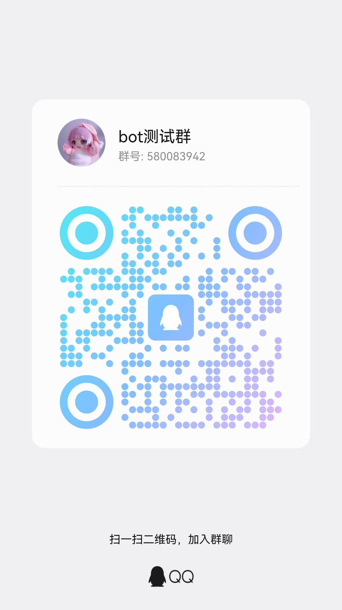

<div align="center">

# 🎭 QQ Bot 多角色扮演系统

**基于 NoneBot2 + snowluma + 多 LLM Provider 的多角色扮演 QQ 机器人**

[](LICENSE)
[](requirements.txt)
[](#运行环境)
[](https://nonebot.dev)


**多角色随时切换 + 语料蒸馏 + 中文 Web 管理面板**  
**面向个人 / 小圈子长跑的多角色 QQ 机器人**

[快速开始](#新手上路) · [功能列表](#功能特性) · [Dashboard 管理面板](#dashboard管理面板) · [推特抓取](#推特语料抓取)

</div>

## 为什么是这个项目

**市面 QQ Bot 主要痛点**：

- 多是群助手 / 单 LLM Provider / 单角色，跟小圈子"一群人想跟 bot 玩一天、第二天让 bot 换 A 角色"的场景对不上
- 角色定义散落各处（人设 / 上下文 / 工作方式），新角色光靠手写维护成本高
- 没有面向个人部署的中文 Web 管理面板，配置和日志全要命令行

**本项目解法**：

- **多角色随时切换**：每个角色 = 独立 Skill（人设 + 工作方式），群聊/私聊用 `/switch <角色名>` 切；今天 A，明天 B，bot 工作方式跟着角色走
- **个人本地化部署**：API Key 在你的 `private/.env`，语料在本地 `corpus/`，角色在本地 `qqbot/characters/` —— **不依赖任何中心化服务**，关掉外网也能跑
- **语料→Skill 蒸馏**：微博 / 推特 / QQ 聊天 → DeepSeek 自动生成 7 层结构 persona，**10 分钟造新角色**
- **多 LLM Provider 四轨架构**（2026-08-30 最新）：
  - **DeepSeek V4-Pro**（主对话，所有对话/工具/流式/用户画像，成本低语气好）
  - **deepseek-vision**（默认视觉 Provider，deepseek-v4-flash-vision-exp，图片转文字）
  - **SiliconFlow Qwen3.5-9B**（可选视觉 Provider，保留兼容）
  - **MiniMax M3**（视觉备用 Provider，保留兼容）
  - **四 Provider 独立互不干扰**，敏感词过滤不会因为 context 触发，识图失败可切换备用
- **中文 Web 管理面板**：8 套主题切换 + 实时 turn 流 + 一键启停 + 端口自动清理

## 和同类项目的区别

| 维度 | 本项目 | 典型群助手类 | 企业客服类 |
|---|---|---|---|
| 角色数量 | **17 个内置（真人 + 二次元） + 无限自建** | 1 个 | 1-3 个 FAQ bot |
| LLM Provider | **四轨独立 + 热切换**（DeepSeek 对话 / deepseek-vision 视觉默认 / SiliconFlow 视觉可选 / MiniMax 备用） | 单 Provider | 单 Provider 或企业私有 |
| 多模态识图 | **✅ deepseek-vision（默认） / SiliconFlow Qwen3.5-9B（可选） / MiniMax M3（备用）** | ❌ | ❌ |
| 语料来源 | 微博 / 推特 / QQ 群聊 / 文本 / 萌娘百科（二次元角色） | 仅文本 | 文档库 |
| 部署形态 | 单机本地（Conda env `botenv`） | 公有云 | 私有云/SaaS |
| Web 管理面板 | **✅ 中文 + 8 套主题** | 多数无 | 后台 |
| 实时对话流水 | **✅ SSE 流 + 聚合统计** | ❌ | ❌ |
| 白名单群自动回复 | **❌ 已移除（2026-09 起群聊必须 @ 或 `/` 命令）** | ❌ | ❌ |
| License | MIT | 多为 AGPL | 多为企业专有 |

> 总结：本项目专注于**个人 / 小圈子长跑场景**，不追求企业级功能（多租户、SSO、审计日志等）。

## 效果样例

<details>
<summary>📸 Dashboard 截图（点击展开）</summary>


*8 套主题切换 / 实时 turn 流 / 进程监控 / 角色花名册*

</details>

<details>
<summary>💬 示例对话（脱敏后，看 7 层结构跑出来什么样）</summary>

> **User**: 今天吃了啥  
> **Bot**: 下午吃了三明治和咖啡呢～ 这周 lofter 发了新图你要看不  
> *(附带 `[图片描述: 用户自拍在咖啡馆角落]` → 视觉 Provider 描述后 DeepSeek 处理回复)*  
>
> **User**: 推荐个周日放松的歌吧  
> **Bot**: 我最近一直循环 **pluviophile** 那种长线条电子～ 网易云搜 "lo-fi chillhop morning" 也有类似味道✧  
> *(触发联网搜索关键词 → 搜索结果整合 → 角色语气自然表达)*

</details>

<details>
<summary>🌐 推特语料抓取 + 角色蒸馏</summary>

```
$ python scripts/fetch_twitter.py elonmusk --count 100
🍪 加载已有 cookies (含 auth_token)
  抓到 100 条 tweets_raw.json + corpus.txt
```

推文落到 `corpus/twitter_<name>/`，Dashboard 一键蒸馏生成 7 层结构 persona。完整工作流见「[推特语料抓取](#推特语料抓取)」。

</details>

## 架构

```
QQ 客户端 ←→ SnowLuma (OneBot v11) ←WebSocket→ NoneBot2 (port 8080)
                                                  ↕
                                               char_chat 插件
                                               ├─ DeepSeek V4-Pro (默认主对话,处理所有对话 / 工具 / 流式 / 用户画像)
                                               ├─ deepseek-vision (默认图片描述 Provider,deepseek-v4-flash-vision-exp)
                                               ├─ SiliconFlow Qwen3.5-9B (可选图片描述 Provider,视觉转文字)
                                               ├─ MiniMax M3 (视觉备用 Provider)
                                               ├─ 百度 + 微博(单帖/热搜) 联网搜索
                                               └─ 流式输出 + Function Calling

Dashboard (port 8501) ←→ 进程管理 / 微博+推特语料采集 / Skill 蒸馏 / 头像管理 / 热重载 / 实时对话流水
SnowLuma WebUI (port 5099) ←→ 扫码登录 QQ / 连接状态
manage.bat             ←→ 统一入口（启动 Dashboard + 浏览器，端口自动清理）
```

## 新手上路

### 前置条件

在开始之前，请确保你的电脑已安装以下软件：

| 软件 | 要求 | 下载 |
|------|------|------|
| Anaconda / Miniconda | 任意版本，用于创建独立 `botenv` 环境（Python 3.12） | [anaconda.com](https://www.anaconda.com/download) |
| Python（conda 会自动安装） | 3.12（botenv 内） | — |
| QQ 桌面版 (QQNT) | 最新版 | [im.qq.com](https://im.qq.com/) |
| SnowLuma | 最新版 Windows x64 | [MaaYYDS/SnowLuma Releases](https://github.com/MaaYYDS/SnowLuma/releases) |
| DeepSeek API Key（主对话必填；默认识图 deepseek-vision 也复用此 Key） | 注册后在 API Keys 页面创建 | [platform.deepseek.com](https://platform.deepseek.com) |
| SiliconFlow API Key（识图可选，非默认） | 硅基流动，注册后获取 | [cloud.siliconflow.cn](https://cloud.siliconflow.cn) |
| MiniMax API Key（识图备用，可选） | 注册后在 API Keys 页面创建 | [api.minimaxi.com](https://api.minimaxi.com) |
| Git | 任意版本 | [git-scm.com](https://git-scm.com/) |

> 本项目仅支持 **Windows** 系统。硬编码 conda 路径为 `D:\Work\anaconda3\envs\botenv\`，如需调整需修改 `scripts/bat/setup.bat`、`scripts/bat/launch_dashboard.ps1` 和 `qqbot/dashboard/monitor.py` 中的路径常量。

> **环境迁移记录（重要）**：
> - 2026-07-01：QQ 协议层从 NapCat Desktop 迁移到 **SnowLuma**（node.exe 版本）
> - 2026-07-23：Python 环境从 `skill_qqbot/` venv 迁移到 **conda env `botenv`**。原因：venv launcher（python.exe）是 Stub，会转发到 base python（`D:\Work\anaconda3\python.exe`），导致 uvicorn watchfiles / multiprocessing 派生的 worker 进入错误的解释器拿不到依赖。conda 的 python.exe 是真独立解释器，无此问题。

### 安装步骤

**第一步：克隆仓库**

在任意目录下打开终端（CMD 或 PowerShell），执行：

```bash
git clone <你的仓库地址>
cd skill_communication
```

> 以下所有操作都在 `skill_communication` 目录内进行。

**第二步：运行安装脚本（setup.bat）**

双击 `scripts/bat/setup.bat`（或在终端中执行 `scripts\bat\setup.bat`），脚本会自动完成：

- 检测 Anaconda 是否可用（`D:\Work\anaconda3\Scripts\conda.exe`）
- 创建 conda env `botenv`（Python 3.12，路径 `D:\Work\anaconda3\envs\botenv\`）
- 在 `botenv` 里 `pip install -r requirements.txt` 安装所有 Python 依赖
- 安装 Playwright Chromium（用于微博语料抓取浏览器内 AJAX）
- 从 `qqbot/.env.example` 生成配置文件（实际配置位置：`private/.env`）

如果看到 "环境部署完成！" 字样，说明安装成功。

> ✅ **已修复（2026-08-30）**：setup.bat 已改为向 `private/.env` 写配置模板（自动创建 private/ 目录），不再生成无用的 `qqbot/.env`。同时修正了 SnowLuma 检查路径（原 `%~dp0snowluma` 会错误指向 scripts/bat 下）。

**第三步：编辑配置文件 private/.env**

用任意文本编辑器打开 `private/.env`（没有就新建），填入以下必填项：

```ini
# ============================================================
#  NoneBot2 基础配置（NoneBot2 框架自身读取）
# ============================================================
HOST=0.0.0.0
PORT=8080                               # NoneBot2 监听端口（SnowLuma 通过反向 WS 连到此端口）
COMMAND_START=["/"]
COMMAND_SEP=[" "]
SUPERUSERS=[]

# ============================================================
#  主对话 Provider（必填，当前默认 DeepSeek）
# ============================================================
DEEPSEEK_API_KEY=sk-你的DeepSeek密钥
DEEPSEEK_BASE_URL=https://api.deepseek.com
DEEPSEEK_MODEL=deepseek-v4-pro

# ============================================================
#  视觉 Provider（识图三选一，默认 deepseek-vision）
# ============================================================
# --- 方案 A（默认）：DeepSeek 官方多模态 deepseek-vision ---
DEEPSEEK_VISION_ENABLED=true
DEEPSEEK_VISION_MODEL=deepseek-v4-flash-vision-exp
# 复用上面的 DEEPSEEK_API_KEY / DEEPSEEK_BASE_URL，无需新增凭证

# --- 方案 B（可选）：SiliconFlow 硅基流动 Qwen3.5-9B ---
SILICONFLOW_ENABLED=false
SILICONFLOW_API_KEY=sk-你的SiliconFlow密钥
SILICONFLOW_BASE_URL=https://api.siliconflow.cn/v1
SILICONFLOW_MODEL=Qwen/Qwen3.5-9B

# --- 方案 C（备用）：MiniMax M3 ---
MINIMAX_ENABLED=false                   # 默认视觉走 deepseek-vision 时保持 false 即可
MINIMAX_API_KEY=sk-cp-你的MiniMax密钥
MINIMAX_BASE_URL=https://api.minimaxi.com/v1
MINIMAX_MODEL=MiniMax-M3
MINIMAX_FAST_MODEL=MiniMax-M2.7-highspeed

# ============================================================
#  Bot 身份与权限
# ============================================================
ADMIN_QQ=你的QQ号                       # 管理员 QQ 号（仅这一个/多个，逗号分隔）

# ============================================================
#  Dashboard
# ============================================================
DASHBOARD_TOKEN=自定义一个密码           # 管理面板访问密码（留空则自动生成随机 token 写入日志）

# ============================================================
#  默认角色 & 主选 Provider（2026-07-23 最新默认）
# ============================================================
DEFAULT_SKILL=761                       # 启动时的默认角色编号
ACTIVE_LLM_PROVIDER=deepseek            # 主选对话 Provider（deepseek / minimax，推荐 deepseek）

# ============================================================
#  白名单群自动回复（已移除，历史项；留着不影响启动）
# ============================================================
# 2026-09 起群聊必须 @Bot 或使用 / 命令才会回复，以下变量已不再生效。
AUTO_REPLY_GROUP_IDS=123456789,987654321   # 历史配置：群号列表，中英文逗号分隔
AUTO_REPLY_GROUP_PROBABILITY=0.15           # 历史配置：触发概率 0~1（当前代码不读取）

# ============================================================
#  其他
# ============================================================
# Bot 活跃时段（小时 0-23）
ACTIVE_HOURS_START=0
ACTIVE_HOURS_END=23

# 联网搜索开关
WEB_SEARCH_ENABLED=true

# 推特抓取登录信息（可选，否则用 Dashboard 上传 Cookie）
# TWITTER_USERNAME=你的X账号
# TWITTER_PASSWORD=你的密码
# TWITTER_EMAIL=你的邮箱
```

> 其余运行时参数（流式阈值 / 历史轮数 / 识图开关 / LLM temperature 等）**在 Dashboard「参数设置」页动态调整**，无需写 `.env`。

**第四步：安装 SnowLuma**

1. 从 [MaaYYDS/SnowLuma Releases](https://github.com/MaaYYDS/SnowLuma/releases) 下载 `SnowLuma-v*-win-x64.zip`（或 `SnowLuma-*-win-x64.zip`，带 node.exe 的版本）
2. 在项目**根目录**下新建 `snowluma/` 文件夹
3. 将 zip 解压到 `snowluma/`，最终结构应为：
   ```
   skill_communication/
   └── snowluma/
       └── SnowLuma-v2.2.0-win-x64/      ← 版本号按实际
           ├── node.exe
           ├── index.mjs
           ├── client/                   ← WebUI 静态资源
           ├── config/                   ← 首次启动后生成（onebot_<QQ>.json 等）
           └── data/                     ← 登录态与消息库（首次登录后生成）
   ```
   > ⚠️ v2.2.0 的 zip 里是**根级文件**（`node.exe` / `index.mjs` / `client/` / `native/`），没有版本号目录，所以要手动新建 `snowluma\SnowLuma-v2.2.0-win-x64\` 再解压进去（旧版 v1.10.3 的包自带版本目录）。Dashboard 按 `snowluma/SnowLuma-*` 字典序取第一个，目录名保持 `SnowLuma-<版本>-win-x64` 即可。
4. 运行 `scripts/bat/setup_snowluma.bat`，脚本会自动写入反向 WebSocket 连接配置（连接到 NoneBot2 的 8080 端口）
5. 启动 SnowLuma 后打开 WebUI（http://localhost:5099）：v2.2.0 首次使用需要重新点一次「同意 EULA / 隐私政策」（协议文件有更新，旧同意记录会失效；只影响网页面板，不影响 QQ 收发）

> **SnowLuma WebSocket 配置说明（setup_snowluma.bat 自动完成，通常无需手动）**
>
> 配置文件路径（v2.x）：`snowluma/SnowLuma-<版本>/config/onebot_<QQ号>.json`
> （旧版 v1.10.3 及更早是 NapCat 式路径 `.../resources/app/snowluma/config/onebot11_{QQ号}.json`，仅历史参考）
>
> 若需要手动在 SnowLuma WebUI（http://localhost:5099）配置：
> 1. 左侧 **网络配置** → **新建** → **WebSocket 客户端**
> 2. 参数如下：
>
> | 参数 | 值 |
> |---|---|
> | 启用 | 开（配置字段 `enabled: true`） |
> | 名称 | `qqbot`（随意） |
> | URL | `ws://127.0.0.1:8080/onebot/v11/ws` |
> | 消息格式 | `array` |
> | Token | 留空 |
> | 重连间隔 | `5000` ms（配置字段 `reconnectIntervalMs`） |
> | 上报自身消息 | 关 |
>
> v2.2.0 的 `wsClients` 不再有独立的「心跳间隔」字段（旧版的 `heartInterval` 已废弃，会被兼容解析器忽略）。

**第五步：首次扫码登录 QQ**

方式 A（Dashboard 网页，推荐）：
```
1. 双击 manage.bat 启动 Dashboard → 自动打开浏览器 http://localhost:8501
2. 登录 Dashboard → 进程管理 → SnowLuma 卡片点「启动」
3. SnowLuma 启动后打开其 WebUI：http://localhost:5099
4. 在 WebUI 里输入机器人 QQ 号 → 生成二维码 → 手机 QQ 扫码确认登录
5. 看到「在线」状态即可，之后 Dashboard 启动 SnowLuma 会自动登录（无需再扫码）
```

方式 B（命令行）：
```bat
cd snowluma\SnowLuma-v2.2.0-win-x64
node.exe 你的QQ号
```
扫码后按 Ctrl+C 关闭（首次登录只需一次）。

**第六步：启动 Bot**

```bat
:: 方式一：使用 manage.bat（推荐，主入口，桌面快捷方式也指向它）
双击 manage.bat
→ 自动启动 Dashboard（后台窗口，无黑框）
→ 自动打开浏览器 http://localhost:8501
→ 在 Dashboard 进程管理页面点「启动 NoneBot2」+「启动 SnowLuma」
```

```bat
:: 方式二：命令行前台启动（调试用，有日志输出）
D:\Work\anaconda3\envs\botenv\python.exe qqbot\dashboard.py
```

> **快捷方式**：运行 `scripts\bat\create_shortcut.bat` 可在桌面创建 Dashboard 快捷方式，以后双击即可打开。

> **注意**：start_all.bat 已 **弃用** 于 2026-07-01。现在全部通过 `manage.bat` + Dashboard 网页管理。

## QQ Bot 命令

| 命令 | 说明 | 权限 |
|------|------|------|
| `/skills` | 查看所有可用角色 | 所有人 |
| `/switch <角色名>` | 切换角色 | 仅管理员 |
| `/current` | 查看当前角色和模型 | 所有人 |
| `/reset` | 清空对话记忆 | 所有人 |
| `/reloademoji` | 热重载表情文件 | 仅管理员 |

私聊直接发消息，群聊 @Bot 触发回复。

## manage.bat 一键启动

桌面快捷方式 `QQ Bot.lnk` 指向 `manage.bat`。双击拉起 dashboard，自动打开浏览器到 `http://localhost:8501`。
dashboard 接管 bot / snowluma 的完整生命周期（启停 / 状态 / 一键 full-restart）。

```powershell
# 内部分两步:
#   1. manage.bat 调用 scripts/bat/launch_dashboard.ps1
#   2. ps1 用 Start-Process -WindowStyle Hidden 启 pythonw -m uvicorn qqbot.dashboard.main:app
# (pythonw.exe + CREATE_NO_WINDOW 防止 WindowsTerminal hijack)
```

底层: `scripts/bat/launch_dashboard.ps1`

## 角色 Skill 体系

每个角色是一个独立的 Skill —— 一个 `qqbot/characters/<角色名>/` 目录，至少包含：

```
qqbot/characters/角色名/
├── SKILL.md       # 元数据（角色名 / 描述 / 版本）；可选承载"控制层"正文，见下
├── persona.md     # 七层人设（核心规则 → 关系 → 表达DNA → 情感 → 冲突 → 记忆）
├── work.md        # 可选 — 工作方式（接什么活 / 怎么接）
├── modes/         # 可选 — 模式库（配合 include_subdirs 注入 system_prompt）
└── corpus_ref/    # 可选 — 造角色时的语料快照（语料搜索的兜底来源）
```

**预置示例角色**：`761` —— 完整人设/工作方式样例，可以直接跑，也可以用作你自己造新角色的模板。

### 可选 front matter 字段

`SKILL.md` 的 front matter 里除了 `display_name` / `description` / `version`，还有三个由加载器
（`qqbot/plugins/char_chat/skill_manager.py::load_skill`）实际消费的开关。**全部可选，不写就是默认行为**：

| 字段 | 默认 | 作用 |
|---|---|---|
| `include_skill_body: true` | `false` | 把 `SKILL.md` **正文**也注入 system_prompt。默认只把 front matter 当元数据、正文静默丢弃 —— 若正文承载"必须被执行"的逻辑（身份路由 / 分级规则 / 模式触发表），就要打开它 |
| `include_subdirs: modes` | 空 | 把指定子目录下的 `*.md` 注入（逗号分隔可写多个）。注意 `glob("*.md")` 不递归，子目录默认会被静默忽略 |
| `allowed_users: 123456,789` | 空 | 角色级访问白名单（QQ 号，中英文逗号均可）。**空 = 所有人可对话**；非白名单用户的消息在规则层就被拦掉（`rules.py::_sender_allowed`），不进 handler、不触发"唔…让窝想想"提示、也没有 LLM 调用开销 |

`name:` / `user-invocable:` / `character:` / `research_profile:` 属于纯元数据，加载器不读：
**角色的 key 永远是目录名**，所以 `/switch` 后面要写目录名（写 front matter 里的 `name` 会找不到角色）。
其中 `character` / `research_profile` 只被 Dashboard 的蒸馏管线使用，合法值是
`colleague` / `relationship` / `celebrity` × `budget-friendly` / `budget-unfriendly`；
手写角色填别的值不影响加载，但别对它们点「重新蒸馏」（会用 celebrity 模板覆写 persona/work）。

> ⚠️ **成本提醒**：`include_subdirs` 是**无差别全量注入**，不是按触发词懒加载。一个 6 文件两万字符的
> `modes/` 会全程常驻 context，让每轮 prompt 显著变大（带控制层正文 + 模式库的角色实测可达
> 70k 字符 system_prompt，约为普通角色的 3 倍）。只在少数轮次才用到的模式库，请自行权衡是否常驻。

### 造新角色的三种方式

| 方式 | 速度 | 适合 |
|---|---|---|
| **从零手写** | 30 min - 2 h | 已经想清楚人设 |
| **从语料蒸馏** | 10 min | 有微博/推特/QQ 聊天 → 自动生成 7 层结构 persona |
| **从克隆修改** | 15 min | 复制 `qqbot/characters/761/` 改 meta + persona |

蒸馏流程在 Dashboard → 语料库 → 抓取 → 「生成技能」一键完成。

### 多角色切换

群聊 / 私聊用 `/switch <角色名>` 命令切换角色（仅管理员可切）。所有用户从下一条消息起看到新角色。**热切换无需重启**，bot 加载新 persona 后立即生效。

### 仓库 vs 本地的角色

| 在哪儿 | 内容 | 怎么管 |
|---|---|---|
| **本仓库 / 公开 GitHub** | 只放代码、文档与模板（`snowluma_onebot_config.example.json`、`.env.example` 等），**不含任何角色本体** | `.gitignore` 排除 `qqbot/characters/` |
| **你本地** | 全部 17 个角色（含 `761` 模板） | `qqbot/characters/<角色名>/` |
| **运行时加载** | bot 启动时扫描 `qqbot/characters/` 下所有目录 | 自动 |

> 这样 GitHub 公开仓库和你的隐私角色分布天然分离 —— 角色、语料（`corpus/`）、共享背景（`normal-paper/`）、头像（`photo/`）都只留在本地，不会因为公开仓库泄漏。
> 新建角色的三件套写法见本章节上方「角色 Skill 体系」。

## 功能特性

### 联网搜索

Bot 内置联网搜索，当用户消息包含搜索意图关键词（如"查一下"、"最新"、"是谁"）或 URL 时自动触发，无需手动开启。搜索以**百度**为唯一通用引擎，并用**微博单帖正文 / 微博热搜**做增强（均免 cookie），采用相关性过滤 + 健康检查 + 自动降级策略。搜索结果经 LLM 整合后以自然语言回复。

LLM 的 Function Calling 机制让模型自主决定是否搜索、搜什么、是否跟进网页内容，最多执行 3 轮工具调用。可通过 `.env` 中 `WEB_SEARCH_ENABLED=false` 关闭，或通过 Dashboard 参数设置页面动态调整。

### URL 内容抓取

用户发送的消息中包含 URL 时，Bot 会自动抓取页面内容并注入上下文。支持的特殊链接包括：

- **Bilibili**：解析 BV 号，通过 API 获取视频标题、简介、播放量等信息
- **短链接**：自动解析 302 重定向获取真实地址
- **普通网页**：提取正文内容（去 HTML 标签，截断超长内容）

### 情绪表情系统

Bot 会根据对话内容的情绪自动发送对应的表情图片（GIF/JPG/PNG）。表情文件按情绪分类存放在 `emoji/` 目录下，每个子目录包含一个 `keywords.txt` 定义触发词。

当前支持 10 种情绪分类：angry、curious、happy、laugh、proud、sad、shy、surprised、thinking、tired。

触发规则：50% 概率触发，同一用户 60 秒冷却，避免刷屏。管理员可通过 `/reloademoji` 命令热重载表情文件。

### 流式输出

Bot 默认启用流式回复，先通过一次非流式"探测"判断是否需要工具调用，若为普通文本回复则切换为流式输出，分段发送。流式参数（累积字符数、间隔、最小字符数、最大单次大小）可通过 Dashboard「参数设置」页动态调整，无需重启。

### 多模态识图（默认 deepseek-vision）

用户给 bot 发图片时，bot 会**自动识别图内容**并自然回应（不区分表情包/截图/自拍）。

数据流：

```
QQ 图片消息 → snowluma (OneBot v11 image segment, 含 cdn url)
           → bot 提取 url → 先下载转 base64 → deepseek-vision 视觉理解
           → 输出 [图片描述: ...] → 注入上下文 → DeepSeek 处理回复
```

技术细节：

- **协议**：snowluma 推送的 image segment 通常自带 `url` 字段（QQ 临时签名 CDN）。视觉 Provider 优先级为 `deepseek-vision` → `SiliconFlow` → `MiniMax`，默认走 `deepseek-vision`（`deepseek-v4-flash-vision-exp`，复用 `DEEPSEEK_API_KEY`）。
- **默认转 base64**：DeepSeek 官方视觉模型让服务端 fetch 远程图不稳定（常见 400），所以命中 `deepseek-vision` 时一律先下载图片转 base64 data URI；`SiliconFlow` / `MiniMax` 保留直链策略。
- **历史策略**：多轮对话历史里**只存文字占位符**（如 `[用户上一条消息里发了一张图片]`），不带图，省 token。
- **降级兜底**：若 image segment 没有 url 字段（罕见），回退到本地下载 + base64；若全部视觉 Provider 都不可用，本次 turn 跳过失图。
- **不依赖浏览器**：纯 HTTP 协议，不需要 headless Chrome / playwright。

### LLM Provider 四轨架构（2026-08-30 最新重构）

**四个 Provider 永远同时在线，分工明确、独立运行，绝不互相兜底（避免"幽灵调用"）**：

| Provider | 模型 | 角色 | 适用场景 | 状态 |
|---|---|---|---|---|
| **DeepSeek**（主对话，唯一） | deepseek-v4-pro | 处理**所有对话 / 工具调用 / 流式 / 用户画像** | 成本低、JSON 模式稳定、人设语气好 | ✅ 默认启用 |
| **deepseek-vision**（默认视觉） | deepseek-v4-flash-vision-exp | **图片描述专用**：把图片转成纯文字描述 | 复用 DeepSeek 同平台 Key，少维护一套凭证 | ✅ 默认启用 |
| **SiliconFlow 硅基流动**（可选视觉） | Qwen/Qwen3.5-9B | **图片描述专用**：把图片转成纯文字描述 | 多模态好，性价比高，无敏感词误伤 | ⚡ 可选 |
| **MiniMax**（备用视觉） | MiniMax-M3 | 图片描述 Provider **备用方案**（前两家都不可用时切） | 兼容保留 | ⚡ 可选备用 |

#### 调用流程

```
用户发消息（含/不含图片）
   │
   ├─ 不含图 ───────────────────────→ 直接 DeepSeek 处理回复
   │
   └─ 含图 ──┬─ [默认] deepseek-vision 看图 → 输出 [图片描述: ...]
            ├─ [可选] SiliconFlow (Qwen3.5-9B) 看图（deepseek-vision 关了）
            └─ [备用] MiniMax M3 看图（前两家都关了）
                              ↓
                    DeepSeek 拿纯文本（含描述）处理回复
```

**关键设计**：视觉 Provider（deepseek-vision / SiliconFlow / MiniMax）**永远只接收图片 + 用户文字提示，不接触对话历史 / persona / thinking**，彻底避免它们自带的敏感词过滤因为上下文中的某句话被意外触发。

#### 配置 Provider

**主对话 Provider**（Dashboard 可热切换，默认 deepseek）：
- Dashboard「参数设置」→「主对话 Provider」下拉框
- 切换后自动写入 `qqbot/data/runtime_settings.json`，bot 热加载
- 选项：`deepseek` / `minimax`（minimax 做对话不推荐，自带敏感词易 422）

**图片描述 Provider 选择（2026-08-30 更新）**：
- 优先级：若 `DEEPSEEK_VISION_ENABLED=true` 且 DeepSeek key 有效 → 用 deepseek-vision
- 否则若 `SILICONFLOW_ENABLED=true` 且 key 有效 → 用 SiliconFlow
- 否则若 `MINIMAX_ENABLED=true` 且 key 有效 → 用 MiniMax
- 都关 → `image_handler_enabled` 运行时开关直接跳过失图，回复为"（图片一张，暂无法识别）"

**识图总开关（运行时）**：Dashboard「参数设置」→ `image_handler_enabled`，临时关了不会报错，直接跳过图片处理。

**切换策略（不自动兜底，出问题明确报错）**：
- 主对话 Provider 不可用 → 抛 `RuntimeError`，Bot 回复"找主人修一下下"类型文案；需 Dashboard 手动切或修 `.env`
- 识图 Provider 不可用 → 本次 turn 跳过识图，下次消息仍尝试（不会永久禁用）
- **绝不**出现"Dashboard 显示 A，实际悄悄跑 B"的幽灵调用（2026-06-28 之前有，已移除）

启用/禁用：在 `private/.env` 配置：
- `DEEPSEEK_API_KEY`（主对话；只要填了就生效，没有专门的 enable 开关）
- `DEEPSEEK_VISION_ENABLED=true|false` + `DEEPSEEK_VISION_MODEL`（默认视觉，复用 `DEEPSEEK_API_KEY`）
- `MINIMAX_ENABLED=true|false` + `MINIMAX_API_KEY`
- `SILICONFLOW_ENABLED=true|false` + `SILICONFLOW_API_KEY`

通用 LLM 运行时参数（Dashboard 可调，无需重启，实际作用于 active Provider）：

| 参数 | 说明 | 默认 | 影响路径 |
|---|---|---|---|
| `llm_temperature` | 采样温度（2026-07-23 重命名，之前 `minimax_temperature`） | `0.95` | 对话 & 视觉 |
| `llm_top_p` | 核采样 | `0.9` | 对话 & 视觉 |
| `llm_max_tokens` | 单次最大输出 | `16384` | 对话 |
| `llm_reasoning_effort_with_tools` | 带工具调用时的思考强度 | `high` | 对话探测调用 |
| `llm_reasoning_effort_no_tools` | 纯文本时的思考强度 | `high` | 对话探测调用 |
| `image_handler_enabled` | 识图功能总开关（2026-07-23 新增） | `true` | 含图消息 |

#### 错误分类与 fallback 文案

API 失败按 HTTP 错误分类，dashboard/chat.log 显示具体类型，回复给用户的 fallback 文案也不同：

| 错误类型 | HTTP | 用户看到的回复 |
|---|---|---|
| `sensitive` | 422 输入敏感词 | 呜呜泥说的话触发了窝的 safety filter…换个话题好不好嘛🥺 |
| `model` | 400 unknown model | 哎呀当前模型配置有点问题…等窝修一下下🙏 |
| `auth` | 401/403 | 呜…窝的 API key 好像出问题了，找主人修一下下叭 |
| `disallowed` | 400 disallowed url | 呜呜这张图好像有点问题，窝看不粗来… |
| `rate` | 429 | 太多人跟窝说话了呜呜 排队一下下嘛🙏 |
| `server` | 5xx | 上游模型服务在打盹儿…稍等一下下再来戳窝叭💤 |
| `unknown` | 其它 | 啊啊窝的脑袋当机惹 [抓狂] 让窝休息一下下… |

**敏感类错误不盲目重试**：sensitive / model / disallowed / auth 这 4 类遇到立即停止，避免浪费 3 次重试 + 触发连续错误。

### 用户画像

Bot 会在对话过程中自动提取用户的简要画像（称呼偏好、兴趣话题等），作为上下文注入后续回复，让角色"记住"对方的特点。画像由 DeepSeek 抽取，定期更新，不影响对话性能。

### 通用背景知识

`normal-paper/` 目录下的 `.md` 文件会作为所有角色共享的领域背景知识自动注入 system prompt。适合存放圈子通用术语、礼仪规则、文化背景等不需要写进每个角色人设的参考资料。支持热重载（随 Skill 一起刷新）。

### 对话流水（turn 流）

Dashboard 新增「对话流水」tab，通过 SSE 实时推送每个 turn 的完整步骤：

- **状态流转**：排队 → 探测 → LLM 调用 → 思考 → 工具调用 → 工具结果 → 流式分块 → 回复
- **元信息**：用户 QQ、群 ID、角色、Provider/Model、工具调用数、回复字符数、耗时
- **聚合统计**：总 turn 数 / 成功率 / 空回复率 / 进行中数 + Provider + Skill + 高频用户分布
- **筛选搜索**：按状态 / 关键字（用户文本、UID、群 ID、角色名）过滤

文件落地在 `qqbot/logs/turns_stream.jsonl`（追加写），单个 turn 的步骤快照在 `qqbot/logs/turns/<date>/*.json`；Dashboard 历史接口从 `turns_stream.jsonl` 尾部聚合并返回。

## Dashboard 管理面板

访问 `http://localhost:8501`


| 页面 | 功能 |
|------|------|
| 进程管理 | KPI 总览（系统/NoneBot2/snowluma/WS 实时状态）、服务启停、Dashboard 自管理、角色花名册 |
| Cookie | 微博 Cookie 状态查看与上传；推特 Cookie 单独管理 |
| 语料库 | 微博抓取 / QQ 群聊导入 / 推特抓取 / 文本导入 / 语料 → Skill 生成 |
| 技能管理 | 角色 Skill 列表/编辑/蒸馏/创建/批量删除/排序筛选 + 头像自动加载 |
| 日志 | 系统日志实时查看（nonebot2.log、chat.log、snowluma.log 等） |
| 帮助文档 | 文档目录侧边栏 + Markdown 渲染 |
| 参数设置 | LLM Provider 切换 + 流式 / 历史 / 联网搜索 / LLM 全参数运行时调整 |
| 对话流水 | turn 流实时 SSE + 历史聚合统计 |

### Dashboard 架构

- **后端**：FastAPI + Uvicorn，`main.py` 只做 app 组装 + 鉴权 + SSR，**45+ 路由按业务拆分到 `routers/` 包**（process/turns/corpus/skills/settings/docs/logs/ws），`monitor.py` 负责 psutil 进程监控
- **前端**：原生 HTML/CSS/JS，**模块化拆分**（17 个 js 文件按 tab/工具分层）+ 6 个 CSS 文件（tweaks 覆盖层已收口并入 2026-08-30）
- **首屏**：SSR-first 注入 `window._INIT_DATA`，首屏立即有数据，避开 `/api/health` 慢查询
- **主题**：8 套主题切换（桜日和 / 蜜桃气泡 / 霓虹终端 / 午夜银河 / 极地霜白 / 绯红机甲 / 琥珀暗夜 / 翡翠霜白），通过 CSS 变量热切换
- **API 鉴权**：中间件白名单（首页/静态资源/`/api/health`/`/api/ws-health`/snowluma SSE 放行），其余 `/api/*` 需 `X-Dashboard-Token` header 或 `?token=` query

### Dashboard 新增功能

**进程管理增强**
- 启动/重启前自动清理占用端口的旧进程（不再出现 Errno 10048 端口冲突）
- Dashboard 自身状态卡片（PID、内存、运行时间），支持网页一键重启
- 顶栏 pill **SSR 兜底**（不等 `/api/health`，首屏立即正确显示）

**技能管理增强**
- **头像自动加载**（用 SSR `init.avatars` 填充 `_PHOTOS`，渲染即可见）
- 排序：按名称 / 创建时间 / 版本号 / 大小
- 实时搜索筛选（名称、描述）
- 批量操作：全选/单选，一键批量删除

**日志查看**
- 内置日志查看器，无需命令行
- 自动清理 ANSI 颜色代码
- 支持自动滚动、选择不同日志文件

**对话流水实时监控**
- SSE 推流（`/api/turns/stream`）
- turn 步骤可视化（每步带类型/耗时/内容）
- 聚合统计 + 多维度筛选

**状态持久化**
- 自动记住上次访问的标签页
- 创建技能表单自动保存草稿
- SSR 兜底 + safeFetch 默认 30s timeout（避开 monitor 慢查询）

### 语料采集与 Skill 蒸馏

**获取微博 Cookie**

1. 用浏览器登录 [weibo.com](https://weibo.com)
2. 按 F12 打开开发者工具 → Network 标签
3. 刷新页面，点击任意请求，在 Request Headers 中找到 `Cookie:` 行
4. 复制完整的 Cookie 字符串

**上传 Cookie 到 Dashboard**

1. 打开 Dashboard → Cookie 页面
2. 粘贴 Cookie 字符串并保存
3. 页面会显示 Cookie 状态（有效/过期）

**抓取微博语料**

1. Dashboard → 语料库页面
2. 输入目标用户的微博 UID（可在用户主页 URL 中找到，如 `weibo.com/u/123456` 中的 `123456`）
3. 点击「抓取」，系统自动下载微博内容到 `corpus/UID/` 目录
4. 抓取完成后，点击语料旁的「生成技能」
5. 选择角色类型（名人/同事/亲密关系），系统调用 DeepSeek 自动生成 Skill 文件

**导入 QQ 聊天记录**

1. Dashboard → 语料库页面 → 导入 QQ 聊天
2. 上传导出的聊天记录文件
3. 系统自动解析并生成 Skill

### 推特语料抓取

通过 `twikit` 库直接走 HTTP 抓取推文，**无需 API Key、无需浏览器**，已内置 X 客户端交易 ID 的 KEY_BYTE 补丁。

**方式 A：上传浏览器 Cookies（推荐，避免风控）**

1. 用浏览器登录 [x.com](https://x.com)
2. 安装 [Cookie-Editor](https://chromewebstore.google.com/detail/cookie-editor/hlkenndednhfkekhgcdicdfddnkalmdm) 扩展
3. 打开扩展 → Export → JSON，保存为 `twitter_cookies.json`
4. Dashboard → 语料库 → 推特抓取 → 上传 Cookies
5. 输入 screen name（如 `elonmusk` 或你想抓取的 X 用户名）→ 抓取

**方式 B：账号密码登录（自动保存 cookies）**

在 `private/.env` 中加入：

```ini
TWITTER_USERNAME=你的X账号
TWITTER_PASSWORD=你的密码
TWITTER_EMAIL=你的邮箱
```

首次抓取时会自动登录并保存 cookies 到 `private/twitter_cookies.json`（已被 `.gitignore` 忽略，不会泄露）。

**抓取选项**

| 选项 | 说明 |
|------|------|
| 抓取条数 | 默认 200 条，可设 1-5000（被 X 限流时建议 50-100） |
| 抓取全部 | 翻页到无数据为止（可能耗时数十分钟） |
| 同时抓取本人回复 | 抓 Tweets + Replies 两类，合并输出 |

**输出位置**：`corpus/twitter_{screen_name}/`
- `corpus.txt` — 可读格式（含互动数据、正文、回复对象、转推来源）
- `tweets_raw.json` — 完整结构化数据（含用户信息、推文元数据、社区笔记、投票）

**命令行使用**

```bash
# 基础抓取
python scripts/fetch_twitter.py elonmusk

# 指定条数
python scripts/fetch_twitter.py elonmusk --count 100

# 抓取全部
python scripts/fetch_twitter.py elonmusk --all

# 同时抓回复
python scripts/fetch_twitter.py elonmusk --all --replies

# 只抓回复
python scripts/fetch_twitter.py elonmusk --all --type Replies
```

## 配置参考

完整配置项写在 `private/.env`（NoneBot2 自身需要的基础变量 + 项目扩展变量）。NoneBot2 官方还会从 `qqbot/.env.example` 找模板，实际生效值以 `private/.env` 为准。

### private/.env 完整参考

| 参数 | 说明 | 默认值 | 必填 |
|------|------|--------|------|
| **基础** | | | |
| `HOST` | NoneBot2 监听地址 | `0.0.0.0` | ✅ |
| `PORT` | NoneBot2 监听端口（SnowLuma 连到此） | `8080` | ✅ |
| `COMMAND_START` | 命令前缀 | `["/"]` | ✅ |
| **主对话 LLM（必填二选一以上，默认 deepseek）** | | | |
| `DEEPSEEK_API_KEY` | DeepSeek API 密钥 | — | ⭕（主对话默认） |
| `DEEPSEEK_BASE_URL` | DeepSeek Base URL | `https://api.deepseek.com` | |
| `DEEPSEEK_MODEL` | DeepSeek 模型名 | `deepseek-v4-pro` | |
| `DEEPSEEK_VISION_ENABLED` | DeepSeek 官方视觉开关（默认视觉） | `false` | 推荐启用 |
| `DEEPSEEK_VISION_MODEL` | DeepSeek 视觉模型名（复用 `DEEPSEEK_API_KEY`） | `deepseek-v4-flash-vision-exp` | |
| `MINIMAX_ENABLED` | MiniMax 开关（视觉备用） | `false` | |
| `MINIMAX_API_KEY` | MiniMax API 密钥 | — | 视觉备用时 |
| `MINIMAX_BASE_URL` | MiniMax Base URL | `https://api.minimaxi.com/v1` | |
| `MINIMAX_MODEL` | MiniMax 模型名 | `MiniMax-M3` | |
| `MINIMAX_FAST_MODEL` | MiniMax 高速模型 | `MiniMax-M2.7-highspeed` | |
| `SILICONFLOW_ENABLED` | 硅基流动开关（可选视觉） | `false` | 可选 |
| `SILICONFLOW_API_KEY` | SiliconFlow API 密钥 | — | 可选视觉时 |
| `SILICONFLOW_BASE_URL` | SiliconFlow Base URL | `https://api.siliconflow.cn/v1` | |
| `SILICONFLOW_MODEL` | SiliconFlow 视觉模型 | `Qwen/Qwen3.5-9B` | |
| **权限 & 默认值** | | | |
| `ADMIN_QQ` | 管理员 QQ 号（多个用中英文逗号分隔） | — | ⭕ |
| `DASHBOARD_TOKEN` | Dashboard 访问密码（空则自动生成随机 token） | — | 推荐 |
| `DEFAULT_SKILL` | 启动默认角色 Skill 名 | `761` | |
| `ACTIVE_LLM_PROVIDER` | 启动主选 Provider（`deepseek` / `minimax`） | `deepseek` | |
| **行为** | | | |
| `ACTIVE_HOURS_START` / `ACTIVE_HOURS_END` | Bot 活跃时段（小时 0-23） | `0 / 23`（全天） | |
| `WEB_SEARCH_ENABLED` | 联网搜索开关 | `true` | |
| `AUTO_REPLY_GROUP_IDS` | **已移除（历史项）**：白名单群号（多群逗号分隔）；代码不再读取，旧 `.env` 留着不影响启动 | 空 | 历史项 |
| `AUTO_REPLY_GROUP_PROBABILITY` | **已移除（历史项）**：白名单群自动回复概率（0~1）；2026-09 起群聊必须 @ 或 `/` 命令 | `0.0`（关） | 历史项 |
| **推特抓取（可选）** | | | |
| `TWITTER_USERNAME` | X 账号 | — | 不用 Cookie 时 |
| `TWITTER_PASSWORD` | X 密码 | — | 不用 Cookie 时 |
| `TWITTER_EMAIL` | X 邮箱 | — | 不用 Cookie 时 |

### 运行时参数（Dashboard「参数设置」可调，无需重启，写入 `qqbot/data/runtime_settings.json`）

| 参数 | 说明 | 默认值 |
|------|------|--------|
| `active_llm_provider` | 当前主选对话 Provider（`deepseek` / `minimax`） | `deepseek` |
| `stream_enabled` | 流式输出开关 | `true` |
| `stream_flush_chars` | 流式累积字符数阈值（分段触发） | `60` |
| `stream_flush_interval` | 流式最长发送间隔（秒，到时间即使不满字符也发） | `8.0` |
| `stream_flush_min_chars` | 流式最小发送字符数（低于此再等下一批） | `80` |
| `stream_time_grace_seconds` | 流式尾部宽容等待秒数（最后一个 flush 前延后） | `1.5` |
| `stream_max_flush_size` | 单次最大发送字符数（超长在此截断分段） | `300` |
| `max_history_rounds` | 最大对话轮数（超过从尾部丢弃） | `100` |
| `history_ttl_hours` | 对话历史过期时间（小时，超出后失效清空） | `36` |
| `history_save_interval` | 历史持久化到磁盘间隔（秒） | `60` |
| `thinking_timer_seconds` | "思考中…"提示延迟发送秒数（避免很快回复还显示思考中） | `120` |
| `multi_turn_enabled` | 多轮对话 / 记忆开关（关了每条消息都当新会话） | `true` |
| `test_mode_enabled` | 测试模式（仅私聊触发回复，群里静默拦截不响应） | `true` |
| `image_handler_enabled` | 多模态识图开关（关则所有含图消息跳过失图） | `true` |
| `active_hours_start` / `active_hours_end` | 活跃时段 | `0 / 23` |
| `web_search_enabled` | 联网搜索开关 | `true` |
| `llm_temperature` | 采样温度 | `0.95` |
| `llm_top_p` | 核采样 p | `0.9` |
| `llm_max_tokens` | 单次最大输出 tokens | `16384` |
| `llm_reasoning_effort_with_tools` | 带工具调用时的思考强度（`low` / `medium` / `high`） | `high` |
| `llm_reasoning_effort_no_tools` | 纯文本回复的思考强度 | `high` |

## 目录结构

```
skill_communication/
├── qqbot/                          # QQ Bot 应用（NoneBot2 主程序）
│   ├── bot.py                      # NoneBot2 入口（读取 private/.env，注册 OneBot v11 adapter）
│   ├── dashboard.py                # Dashboard 前台启动入口（前台模式、有日志）
│   ├── .env.example                # 配置模板（参考用，真实生效值在 private/.env）
│   ├── pyproject.toml              # NoneBot2 配置：注册 OneBot v11 adapter；plugin_dirs=["plugins"]
│   ├── plugins/char_chat/          # ⭐ 核心聊天插件（22 个模块化文件，见下）
│   │   ├── __init__.py             # 插件入口，按依赖顺序导入所有模块
│   │   ├── config.py               # 全局配置（API Key、模型、路径、运行时参数、搜索健康、metrics）
│   │   ├── provider.py             # LLM Provider 管理（deepseek / deepseek-vision / siliconflow / minimax，四轨独立 + 健康）
│   │   ├── api_client.py           # HTTP API 请求（并发控制、重试、错误分类）
│   │   ├── skill_manager.py        # Skill 加载、热重载、角色切换、测试模式
│   │   ├── history.py              # 对话历史管理（持久化到 JSON、TTL 清理、轮数上限）
│   │   ├── user_profile.py         # 用户画像提取（DeepSeek 抽取称呼偏好/兴趣 → 注入上下文）
│   │   ├── avatar.py               # QQ 昵称与头像设置（SnowLuma API）
│   │   ├── search.py               # 联网搜索（百度 + 微博单帖/热搜，健康感知 + 自动降级）
│   │   ├── url_fetcher.py          # URL 提取与内容抓取（BV 号解析、短链展开、正文提取）
│   │   ├── dsml_cleaner.py         # DSML / XML / 思考标记清理
│   │   ├── message_utils.py        # 消息分段、QQ 表情解析、反垃圾
│   │   ├── rich_message.py         # QQ 富消息解析（小程序、XML、卡片分享）
│   │   ├── emoji_system.py         # 情绪表情系统（10 种情绪 + 关键词检测 + 概率 + 冷却）
│   │   ├── llm.py                  # LLM 调用（探测式 + Function Calling + 流式输出）
│   │   ├── rules.py                # 消息匹配规则（@我、命令识别、bot self-id 过滤；白名单群自动回复已移除）
│   │   ├── initiate.py             # 主动暗示概率掷骰（角色级、私聊白名单、默认关闭，2026-09-13）
│   │   ├── commands.py             # 命令注册与处理（reset / skills / switch / current / reloademoji）
│   │   ├── chat_handler.py         # 主消息处理流程（情绪→搜索→LLM→表情→流式分段）
│   │   ├── image_handler.py        # 多模态识图（image_url → 视觉Provider → 文字描述 → 替换注入）
│   │   ├── turn_recorder.py        # turn 流记录（turns_stream.jsonl + 按日 turn JSON 落盘）
│   │   └── lifecycle.py            # 生命周期（启动加载技能/停止保存历史）
│   ├── dashboard/                  # ⭐ Web 管理面板（FastAPI + 原生 HTML/CSS/JS）
│   │   ├── main.py                 # app 组装 + token 鉴权中间件 + SSR 首屏（路由已拆分到 routers/）
│   │   ├── routers/                # ⭐ 路由模块（2026-08-30 拆分）
│   │   │   ├── _shared.py          #   共享常量/路径/安全校验/token 常量时间比较
│   │   │   ├── process.py          #   进程管理 + /api/health(复用状态缓存) + Dashboard 自管理 + snowluma 日志 SSE
│   │   │   ├── turns.py            #   对话流水历史(尾部读取) + SSE 推流
│   │   │   ├── corpus.py           #   Cookie + 微博/QQ/文本语料 + 推特抓取 + 语料蒸馏
│   │   │   ├── skills.py           #   Skill CRUD + 编辑 + 蒸馏(并发保护) + 头像 + AI 特征整合
│   │   │   ├── settings.py         #   运行时参数读写 + LLM Provider 状态(mtime 缓存)
│   │   │   ├── docs.py / logs.py / ws.py   # 帮助文档 / 日志查看 / WebSocket 状态推送
│   │   ├── monitor.py              # 进程监控（端口清理 + psutil + SSE 探活 + 日志流）
│   │   ├── skill_manager.py        # Skill CRUD + 头像管理 + 蒸馏流程
│   │   ├── weibo_fetcher.py        # 微博 + 推特语料采集 + 语料→Skill 蒸馏（调用 DeepSeek）
│   │   └── static/                 # 前端界面（原生，无框架）
│   │       ├── index.html          # 主页面（SSR 注入 window._INIT_DATA + 8 套主题变量）
│   │       ├── photo/              # 头像静态资源（跟根目录 photo/ 同步，Dashboard SSR 用）
│   │       ├── css/ (6 文件)       # themes.css / base.css / layout.css / components.css
│   │       │                       #   editor.css / help.css（tweaks.css 已收口并入 2026-08-30）
│   │       └── js/ (17 文件)       # init.js / core_shared.js / themes.js / kpi.js / wshealth.js
│   │                               #   roster.js / logs.js / corpus.js / dashboard_mgmt.js / twitter.js
│   │                               #   turns.js / help.js / editor.js / snowluma_log.js
│   │                               #   skills_filter.js / form_draft.js / skills_batch.js
│   ├── characters/                 # ⭐ 角色目录（已 17 个，本地私有）
│   │   ├── 761/ (小船chiyori，惑星vortex) · aoyi/ · guuo/ · iteru/ · jinmao/
│   │   ├── koimo/ · mika/ · nana/ · skingfd/ · ytj/ · zyw/ · dot_yuu/   # 真人系（语料来自微博/QQ群）
│   │   ├── momo/ · rose/                                           # 真人系（语料来自推特）
│   │   ├── amadeus-kurisu/ · makise-kurisu/ · yukina/             # 二次元系（命运石之门+噬血狂袭）
│   │   └── <每个角色>/ = SKILL.md + persona.md + work.md + corpus_ref/
│   ├── logs/                       # 运行日志（自动轮转 5MB×3 备份）
│   │   ├── nonebot2.log            # NoneBot2 全部输出（启动/报错/API栈）
│   │   ├── chat.log                # 对话事件日志（用户消息→Bot回复→搜索→流式分段）
│   │   ├── dashboard.out / .err    # Dashboard 后台启动 stdout/stderr
│   │   ├── snowluma.log            # SnowLuma 协议层日志（QQ 收发连接状态）
│   │   ├── turns_stream.jsonl      # turn 实时事件流（追加写，Dashboard SSE tail 它）
│   │   └── turns/                  # 单个 turn 的步骤快照（按日期分目录，*.json）
│   ├── data/                       # 持久化数据（bot 自己读写）
│   │   ├── runtime_settings.json   # Dashboard 运行时参数保存点
│   │   ├── conversation_histories.json  # 对话历史持久化
│   │   ├── user_profiles/          # 用户画像 JSON（每个 QQ 号一个文件）
│   │   └── search_health.json      # 搜索引擎健康状态（持久化，重启恢复）
│   └── _diag_*.py                  # 临时诊断脚本（2026-07-23 排查 conda env 子进程 fork 问题）
├── .work/                          # 临时工作目录（角色改写稿 / 模拟输出，不参与运行）
├── .pids/                          # 旧版 PID 目录（与 .runtime/ 重复，可忽略）
├── skill/                          # 第三方 Skill 参考（titanwings/colleague-skill 副本）
├── scripts/                        # 工具脚本
│   ├── bat/                        # Windows 批处理 & PS1（主运维入口）
│   │   ├── setup.bat               # ⭐ 一键环境部署（conda botenv + pip deps + Playwright Chromium）
│   │   ├── setup_snowluma.bat      # SnowLuma 反向 WebSocket 配置写入
│   │   ├── start_all.bat           # ❌ 已弃用 2026-07-01（保留作迁移提示）
│   │   ├── dashboard.bat           # Dashboard 前台启动（有日志框）
│   │   ├── dashboard_silent.bat    # Dashboard 后台启动（无窗口）
│   │   ├── create_shortcut.bat     # 桌面快捷方式创建（QQ Bot.lnk → manage.bat）
│   │   └── launch_dashboard.ps1    # ⭐ manage.bat 实际调的 PS1（后台 pythonw 启动 + 端口检测）
│   ├── fetch_twitter.py            # 推特语料抓取（twikit + Cookie，无需 API Key）
│   └── weibo_pw_cookies.py         # 微博抓取（Playwright + Cookie 注入）
├── private/                        # ⭐ 隐私配置目录（.gitignore 保护，不外传）
│   ├── .env                        # 主配置文件（API Key / 管理员 QQ / Token）
│   ├── cookies.json                # 微博登录 Cookie（Dashboard 上传）
│   └── twitter_cookies.json        # 推特登录 Cookie（Dashboard 上传或自动保存）
├── snowluma/                       # SnowLuma（QQ 协议层，需手动下载解压）
│   └── SnowLuma-v*-win-x64/
│       └── node.exe                # SnowLuma 启动入口（Dashboard → monitor.py 调用它）
├── corpus/                         # 语料库（微博/推特/QQ/二次元原作摘录）
│   ├── <uid>/                      # 真人微博用户语料（weibo_corpus.txt + weibo_ajax_pageN.json）
│   ├── <twitter_name>/             # 真人推特语料（corpus.txt + tweets_raw.json）
│   └── <二次元名>/                 # 二次元角色语料（corpus.txt + knowledge.md + source/）
│       └── source/                 #   原作摘录 / 萌娘百科参考 / 集数核对 / 中文粉丝向
├── photo/                          # 角色头像源目录（每个 Skill 同名子目录）
│   └── <skill名>/avatar.jpg|png    # Dashboard 同步到 qqbot/dashboard/static/photo/<同名>/
├── emoji/                          # 情绪表情资源（Bot 触发情绪时随机挑一张发出）
│   ├── angry/ curious/ happy/ laugh/ proud/ sad/ shy/ surprised/ thinking/ tired/
│   └── <每类>/ = keywords.txt（触发词） + *.png/jpg（表情图，需自行添加）
├── normal-paper/                   # ⭐ 通用共享背景知识
│   ├── basic/                      # ⚠️ 只有这一层会被自动注入所有角色的 system prompt
│   │   ├── 规则.md                 #   现场礼仪 + "私下联系=开除"
│   │   └── 人设补充.md             #   角色相关的基础设定
│   ├── cmks.md / 通用词汇.md        # 应援词/圈内词汇（2026-09-14 从 basic/ 移出，改为按需检索）
│   ├── common_mix.md               # 通用知识混合
│   ├── jiemei.md / kimikyun.md / starwink.md / wakusei_vortex.md # 圈子设定（偶像/组合）
│   └── 张育闻和skingFD人物分析.md   # 真人角色人物分析
│   # 说明：basic/ 之外的文件不进 prompt，只在角色调用 search_corpus 时被检索（rglob 全目录）
├── assets/                         # 静态资源
│   ├── icon/ icon.ico · qqbot_bot_icon.ico  # 桌面快捷方式 ICO
│   └── images/                     # README 配图
├── docs/                           # 文档
│   ├── dashboard.png               # Dashboard 截图
│   ├── SOP.md                      # ⭐ 运行维护 SOP（SOP-01~09 + 索引 + 快速故障定位表）
│   ├── RELEASE-2026-08-30.md       # 2026-08-30 Dashboard 优化发布说明（更新日志 + 部署/回滚）
│   └── plan-himeragi-yukina.md     # 姬柊雪菜角色引入计划（参考二次元 Skill 流程）
├── archive/                        # 历史归档（旧环境/旧协议）
│   └── 2026-07-23-botenv-migrate/  # 2026-07-23 迁移前的 venv 备份
├── .runtime/                       # 运行时 PID（manage.bat / launch_dashboard.ps1 写入）
│   └── dashboard.pid
├── manage.bat                       # ⭐ 主入口（桌面快捷方式"QQ Bot.lnk"也指向它）
├── requirements.txt                # Python 依赖清单（setup.bat pip install -r 它）
├── LICENSE                         # MIT
├── .gitignore
└── README.md
```

**运行时自动创建的目录**（无需手动创建）：
- `D:\Work\anaconda3\envs\botenv\` - Conda 环境（Python 3.12，setup.bat 创建，所有脚本里硬编码路径）
- `qqbot/data/` - 对话历史 / 用户画像 / 搜索健康持久化
- `qqbot/logs/` - 运行日志（自动轮转）+ turn 流（`turns_stream.jsonl` / `turns/<date>/`）
- `corpus/` - 语料目录（Dashboard 抓取微博/推特时自动创建子目录）
- `.runtime/` - Dashboard PID 文件

**需要自行添加的内容**：
- `emoji/*/` - 表情图片（GIF/JPG/PNG，keywords.txt 已在）
- `photo/<角色名>/avatar.*` - 每个 Skill 的头像（可选，Dashboard 花名册展示）
- `snowluma/SnowLuma-*/node.exe` - 需从 GitHub 下载 SnowLuma 解压

**重要硬编码路径（迁移/换机器时必改）**：

| 文件 | 常量 | 值 |
|---|---|---|
| scripts/bat/setup.bat | CONDA_EXE | `D:\Work\anaconda3\Scripts\conda.exe` |
| scripts/bat/setup.bat | BOTENV_PY | `D:\Work\anaconda3\envs\botenv\python.exe` |
| scripts/bat/launch_dashboard.ps1 | `$venv` | `D:\Work\anaconda3\envs\botenv\pythonw.exe` |
| qqbot/dashboard/monitor.py | VENV_PYTHON | `D:\Work\anaconda3\envs\botenv\python.exe` |

> 这 4 处必须匹配你机器的 Anaconda 安装路径，否则所有启动/安装脚本会报"找不到 python"。

## 运行环境说明

本项目设计为 **Windows 本地单机运行**，所有脚本和路径均已在此环境下验证：

| 环境项 | 要求 / 说明 |
|---|---|
| 操作系统 | Windows 10 / Windows 11（64 位） |
| Python 环境 | **Conda env `botenv`**，路径 `D:\Work\anaconda3\envs\botenv\`（Python 3.12） |
| Conda 根 | `D:\Work\anaconda3\`（必须在此位置，否则改 4 处硬编码路径） |
| 启动脚本 | `.bat` / `.ps1`（PowerShell 5.1，Windows 自带） |
| QQ 协议端 | SnowLuma（Node.exe），需放项目根目录 `snowluma/SnowLuma-*/node.exe` |
| 占用端口 | `8080` NoneBot2 / `8501` Dashboard / `5099` SnowLuma WebUI |

**迁移历史记录（避免踩老坑）**：
- **2026-07-23：Python 运行环境从 venv → Conda env `botenv`**
  - 旧方式：`D:\agent_function\skill_communication\skill_qqbot\Scripts\python.exe`（虚拟 venv）
  - 问题：venv launcher 是 Stub，实际转发到 base python，导致 `uvicorn` / `multiprocessing` fork 出的 worker 进了 Conda base 而非 venv，报 ImportError
  - 新方式：直接用 Conda 建真独立的 `botenv`，目录下的 `python.exe` 是真正的解释器副本，无转发问题
  - 影响：脚本路径硬编码均已改到 Conda 路径；bot.py / dashboard.py 开头仍保留 `sys._base_executable = sys.executable` 保险补丁（无害，保留）
  - bot.py 内 2026-07-23 注入的 `[DIAG Popen]` / `[DIAG uvicorn.run]` 临时诊断打印 **已清理（2026-08-30）**，bot.py 从 92 行精简到 29 行，仅保留 `sys._base_executable` 保险补丁

- **2026-07-01：QQ 协议层从 NapCat Desktop → SnowLuma（MaaYYDS 版）**
  - 旧方式：NapCat Desktop（QQNT 桌面插件版），启动需先开 QQ 再开 NapCat 启动器
  - 新方式：SnowLuma（纯 Node.exe，自带 OneBot v11 协议和反向 WebSocket）
  - 安装位置：`qqbot/snowluma/` → 已改到**项目根目录** `snowluma/`（跟 monitor.py 匹配）
  - 登录方式：SnowLuma WebUI（http://localhost:5099）扫码，无需手动开 QQ 客户端（但建议 QQ 客户端不要同时登同号，避免挤下线）

**Mac/Linux 用户**：本项目暂不支持，需要自行：
1. 替换 SnowLuma 为对应平台版本（或使用 Lagrange.OneBot 等其他 OneBot v11 实现）
2. 将 `.bat` / `.ps1` 启动脚本改写为 `.sh`
3. 修改 4 处 `D:\Work\anaconda3\...` 硬编码路径为 macOS/Linux 的 Conda 路径

## 日志与调试

所有日志存放在 `qqbot/logs/` 目录下（自动创建），超过 5MB 时自动轮转，保留 3 份备份：

| 文件 | 内容 | 查看时机 |
|------|------|----------|
| `nonebot2.log` | Bot 全部输出（启动、Skill 加载、API 调用、错误堆栈） | Bot 启动失败、API 报错、功能异常 |
| `chat.log` | 对话事件（用户消息、Bot 回复、搜索触发、流式分段） | 查看聊天记录、确认搜索是否触发、调试回复内容 |
| `snowluma.log` | snowluma QQ 协议层日志（WebSocket 连接、消息收发） | QQ 消息未收到/未发出、连接断开 |
| `dashboard.log` | Dashboard FastAPI 请求日志 | API 401/500 排查、token 鉴权问题 |

turn 流日志落地在 `qqbot/logs/turns_stream.jsonl`（单个 turn 的步骤快照在 `qqbot/logs/turns/<date>/*.json`），Dashboard 对话流水 tab 实时展示。

快速排查命令：

```bash
# 查看最近的错误
tail -50 qqbot/logs/nonebot2.log | grep -i error

# 查看最近对话
tail -20 qqbot/logs/chat.log

# 实时监控 Bot 输出
tail -f qqbot/logs/nonebot2.log

# 看 turn 流最后几条
tail -5 qqbot/logs/turns_stream.jsonl
```

---

## 运行维护 SOP（标准作业程序）

日常运维标准操作流程已整理为独立文档 → **[docs/SOP.md](docs/SOP.md)**，包含：

- **环境速查**：端口（8080 / 8501 / 5099）、关键路径、日志一览
- **SOP 索引 + 快速故障定位表**：症状 → 直接跳转对应排查项
- **SOP-01 ~ SOP-09** 完整步骤：
  - SOP-01 日常启动 / SOP-02 日常关闭
  - SOP-03 新增角色（真人·微博）/ SOP-04 新增角色（二次元·萌娘百科）
  - SOP-05 群聊触发规则（白名单概率接话已移除） / SOP-06 角色语气调优
  - SOP-07 故障排查清单（8 条）/ SOP-08 升级依赖 / SOP-09 备份

> **最常用 3 条速记**：
> 1. **启动**：双击桌面「QQ Bot」→ Dashboard（localhost:8501）→ 进程管理 → 启动 NoneBot2 + SnowLuma
> 2. **群聊 @不回**：Dashboard → 参数设置 → 取消勾选 `test_mode_enabled` → 保存（九成是这个坑）
> 3. **人设不对**：改 `qqbot/characters/<name>/persona.md` → Dashboard 技能管理「重载技能」→ 私聊 `/reset` 再测

## 添加新角色 Skill

每个角色是一个 `qqbot/characters/角色名/` 目录，最少需要两个文件：

### 文件结构

```
qqbot/characters/新角色/
├── SKILL.md       # 元数据（角色名、描述、版本）
├── persona.md     # 人设（七层结构：核心规则→关系→表达DNA→情感→冲突→记忆）
└── work.md        # 工作方式（可选）
```

### SKILL.md 模板

```markdown
---
display_name: 角色显示名
description: 一行描述
version: 1.0.0
---
```

### persona.md 结构

```markdown
# 角色名 — Persona

## Layer 0: Core Rules（行为底线）
- 你不做什么 / 永远怎么做

## Layer 1: Context（身份和关系）
- 你是谁，和用户什么关系

## Layer 2: Expression DNA（说话方式）
- 口头禅、节奏、语言特征

## Layer 3: Emotional Logic（情感模式）
- 什么时候开心/沉默/防御

## Layer 4: Conflict and Repair（冲突处理）
- 如何回避冲突、如何修复关系

## Layer 5: Memory Signature（核心记忆）
- 最重要的几个记忆锚点
```

### 创建方式

**方式一：Dashboard 语料蒸馏（推荐）**

1. 在语料库页面抓取微博或导入 QQ 聊天记录
2. 点击语料旁的「生成技能」
3. 选择角色类型（名人/同事/亲密关系），系统自动调用 DeepSeek 生成

**方式二：手动创建**

1. 在 `qqbot/characters/` 下新建目录
2. 创建 `SKILL.md`、`persona.md`、`work.md`
3. 在 Dashboard 技能管理页点击「重载技能」或 Bot 下次收到消息时自动加载

**方式三：Dashboard 创建**

在 Dashboard 技能管理页点击「创建」，填写角色信息后系统自动生成模板文件。

### 头像

在 `photo/角色名/` 下放入 `avatar.jpg` 或 `avatar.png`，Dashboard 角色花名册会自动展示。

## 表情系统配置

表情文件存放在 `emoji/` 目录下，每个情绪分类一个子目录。仓库中已包含 `keywords.txt` 触发词文件，但表情图片需要自行添加：

```
emoji/
├── angry/
│   ├── keywords.txt    # 触发词（已包含）
│   ├── 1.jpg           # 需要自行添加表情图片
│   └── 2.gif
├── happy/
│   ├── keywords.txt
│   └── ...
└── ...（共 10 种情绪分类）
```

**添加表情图片：**
1. 准备 GIF/JPG/PNG 格式的表情图片
2. 放入对应情绪目录（如 `emoji/angry/`）
3. 运行 Bot 后使用 `/reloademoji` 命令热重载，或等待自动加载

## 技术栈

| 组件 | 技术 |
|------|------|
| Bot 框架 | NoneBot2 + OneBot V11 Adapter |
| QQ 协议 | SnowLuma（MaaYYDS 版，node.exe OneBot v11 实现） |
| 主对话 LLM | DeepSeek V4-Pro（默认，唯一主对话） |
| 视觉理解（默认） | **deepseek-vision - deepseek-v4-flash-vision-exp**（先下载转 base64，复用 DeepSeek Key） |
| 视觉理解（可选/备用） | SiliconFlow Qwen/Qwen3.5-9B（可选） / MiniMax M3（备用） |
| 联网搜索 | 百度（唯一通用引擎）+ 微博单帖正文/热搜（健康状态持久化 + 自动降级） |
| 推特抓取 | twikit（纯 HTTP，内置 KEY_BYTE 补丁，Dashboard 一键调用） |
| 微博抓取 | Playwright Chromium + Cookie 注入 + 浏览器内 AJAX 翻页 |
| Dashboard | FastAPI + Uvicorn + SSE（对话流）+ SSR（首屏注入） |
| 前端 | 原生 HTML/CSS/JS（模块化：17 js + 6 css），8 套 CSS 变量主题 |
| 语料蒸馏 | DeepSeek API（真人系/二次元系两套模板） |
| 进程监控 | psutil + asyncio（内置于 Dashboard，含端口自动清理） |
| 服务管理 | manage.bat + launch_dashboard.ps1（pythonw 后台启动 + PID 跟踪 + 端口冲突自愈） |
| Python 环境 | Conda env `botenv`（Python 3.12，杜绝 venv launcher 转发问题） |

## 常见问题

**Q: setup.bat 提示找不到 conda / python？**
A: 项目硬编码 Conda 根在 `D:\Work\anaconda3\`。如果装到了 C 盘或其他位置，改这 4 处文件的路径常量：
   - `scripts/bat/setup.bat`（CONDA_EXE + BOTENV_PY）
   - `scripts/bat/launch_dashboard.ps1`（`$venv` 变量）
   - `qqbot/dashboard/monitor.py`（`VENV_PYTHON` 常量）
   然后重新跑 `scripts/bat/setup.bat` 会自动装 botenv。

**Q: manage.bat 一闪就没了 / 浏览器没打开？**
A: 参见 SOP-07 故障 1。先看 `qqbot/logs/dashboard.err` 定位具体错误。常见是 botenv 未安装或端口 8501 残留占用没清。如果日志里写 `pythonw.exe not found` → 先跑 setup.bat。

**Q: manage.bat / Dashboard 里启动找不到 SnowLuma？**
A: 2026-07-01 之后 SnowLuma 要放**项目根目录**下（不是 qqbot/ 里！）：
```
skill_communication/
└── snowluma/
    └── SnowLuma-v2.2.0-win-x64/
        ├── node.exe
        └── index.mjs
```
从 [MaaYYDS/SnowLuma Releases](https://github.com/MaaYYDS/SnowLuma/releases) 下载 win-x64 zip 解压即可。注意 v2.2.0 的 zip 是**根级文件**，要先手动新建 `snowluma\SnowLuma-v2.2.0-win-x64\` 再解压进去（旧版包自带版本目录）；`snowluma/` 下有多版本目录时 Dashboard 按字典序取第一个。

**Q: Bot 启动了但 QQ @了不回消息？**
A: 按 SOP-07 故障 3 的诊断顺序：
1. 先看顶部 **WS pill 颜色**（红=SnowLuma 和 NoneBot2 反 WS 没连上 → 跑 `setup_snowluma.bat`）
2. 再看 Dashboard → 日志 `chat.log` 是否有消息行进来（没进来=SnowLuma 侧没登录 → 去 SnowLuma WebUI localhost:5099 扫码）
3. 最容易踩的坑：**test_mode_enabled 默认是 true**！群聊会被静默拦截。去 Dashboard「参数设置」取消勾选 test_mode_enabled → 保存即可。
4. 白名单群概率接话机制**已于 2026-09 移除**（群聊改为必须 @ 或 `/` 命令）；旧 `.env` 里残留的 `AUTO_REPLY_*` 已不生效。

**Q: Dashboard 打不开 / 端口 8501 被占用？**
A: Dashboard 本身重启按钮会自动 clean_stale_port。如果连 Dashboard 都启不开，PowerShell 手动执行：
```powershell
Get-NetTCPConnection -LocalPort 8501 -State Listen -ErrorAction SilentlyContinue | % { Stop-Process -Id $_.OwningProcess -Force }
Get-NetTCPConnection -LocalPort 8080 -State Listen -ErrorAction SilentlyContinue | % { Stop-Process -Id $_.OwningProcess -Force }
```
然后重开 manage.bat。

**Q: Bot 重启后端口冲突 Errno 10048？**
A: 2026-06-27 后 Dashboard 的「重启」按钮都会先调用 `clean_stale_port()` 自动杀占用进程。如果还出现 → 说明有非 Dashboard 启动的残留 python 进程占用，按上面的 PowerShell 命令手动杀一轮。

**Q: API 报错 401 未授权？**
A: 检查 `private/.env` 里的**实际在用的 Provider** API Key：
   - 主对话失败 → 看 `DEEPSEEK_API_KEY`（或 minimax 主选时的 `MINIMAX_API_KEY`）
   - 识图失败 → 默认 deepseek-vision 复用 `DEEPSEEK_API_KEY`；SiliconFlow / MiniMax 兜底时看对应 Key
   别忘了查对应平台账户余额是否为 0（DeepSeek / SiliconFlow / MiniMax 任一个欠费都会 401）。

**Q: 识图不工作（发图 bot 没描述内容）？**
A: 诊断顺序：
1. Dashboard「参数设置」→ `image_handler_enabled` 必须勾选
2. private/.env 里 `DEEPSEEK_VISION_ENABLED=true`（默认视觉，复用 `DEEPSEEK_API_KEY`），或启用 `SILICONFLOW_ENABLED` / `MINIMAX_ENABLED` 作兜底
3. 去对应平台控制台查余额 / Key 是否有效（DeepSeek / SiliconFlow / MiniMax）
4. 临时不行的话：先关 `image_handler_enabled` 保存 → 再勾上 保存 → 重启 NoneBot2。

**Q: 顶栏 pill 一开始红，20+ 秒才变绿？**
A: 2026-06-27 后 SSR 兜底已修好。如果还出现：
   - token 为空时 dashboard 会生成随机 token 并打印到 dashboard.out
   - 刷新浏览器确保走正常登录流程（弹框输 DASHBOARD_TOKEN，localStorage 存下）
   - 有防火墙拦截 127.0.0.1 的 8501 自连接也可能导致 pill 红

**Q: 切换主选 Provider 后没生效？**
A: Dashboard「参数设置」→ 选择 `active_llm_provider` → 点保存。下次新 turn 立即生效（无需重启 NoneBot2）。注意选项目前只有 `deepseek` / `minimax` 两种，SiliconFlow 是视觉专用 Provider 不进对话路由。

**Q: 对话流水 Tab 一直 401？**
A: 浏览器 EventSource（SSE）API 不能带自定义 header，token 通过 `?token=xxx` query 传递。Dashboard 正常登录时前端会自动拼 query。
   - 如果是手动开 URL → 改成 `http://localhost:8501/?token=你的DASHBOARD_TOKEN`
   - 如果忘了 token 又没写 private/.env → 看 `qqbot/logs/dashboard.err`，首次启动没填 `DASHBOARD_TOKEN` 会自动生成并打印到日志。

**Q: test_mode 是什么？为什么群里@了不回？**
A: `test_mode_enabled = true` 时：
   - **私聊 Bot**：正常触发（管理员测试用）
   - **所有群聊**：静默拦截（日志会打 "group silent"，用户侧无任何反应）
   默认开着是防止新用户装好就被群里一堆人@把余额打没。群里真要用 → Dashboard「参数设置」取消勾选保存即可。

## 效果测试群
目前运行bot效果可加群查看

## Roadmap

接下来想做的事：

- [ ] **多 Bot 实例管理**（同一进程跑多个 QQ 号，独立 / 角色分发）
- [ ] **角色记忆图谱**（用 Neo4j 关联角色关系 / 用户画像交叉）
- [ ] **语音消息 TTS 回复**（Edge TTS / GPT-SoVITS / 用户自训音色）
- [ ] **Web 管理面板移动端适配**（PWA / responsive layout）
- [ ] **Config UI 化**（Dashboard 直接编辑 private/.env，不用改文件）
- [ ] **多语料源聚合蒸馏**（同时混微博 + 推特 + QQ 群聊生成 7 层结构 persona）

已经做了：

- [x] **四轨 LLM Provider 独立架构**（DeepSeek 主对话 + deepseek-vision 视觉默认 + SiliconFlow 视觉可选 + MiniMax 视觉备用 — 2026-08-30）
- [x] **SiliconFlow 视觉 Provider 接入**（Qwen/Qwen3.5-9B，可作视觉可选/兜底 — 2026-07-23）
- [x] ~~**白名单群自动回复**（按概率触发，无需@ — 2026-07-23）~~ **已于 2026-09 移除：群聊必须 @ 或 `/` 命令**
- [x] **新增 `image_handler_enabled` 识图总开关**（Dashboard 参数设置可热关 — 2026-07-23）
- [x] **运行时参数从 `minimax_*` → `llm_*` 通用化**（改名以匹配 DeepSeek 主选身份 — 2026-07-23）
- [x] **默认历史轮数 / TTL 调大**（40 → 100 轮，6h → 36h TTL — 2026-07-23）
- [x] **Python 环境从 venv → Conda env `botenv` 迁移**（根治 venv launcher 转发问题 — 2026-07-23）
- [x] **QQ 协议从 NapCat Desktop → SnowLuma（MaaYYDS 版）迁移**（不再依赖 QQ 客户端 — 2026-07-01）
- [x] **多 LLM Provider 双轨**（DeepSeek + MiniMax M3 互不干扰 — 2026-06-28）
- [x] **推特语料抓取**（twikit + Cookie 注入 — 2026-06-27）
- [x] **Dashboard 实时 turn 流**（SSE + 历史聚合统计）
- [x] **snake_case 模块化拆分**（17 个 JS + 6 个 CSS，按 tab 分层）
- [x] **JPEG/PNG 表情自动加载**（按角色目录 + 头像预览）
- [x] **清理 bot.py 临时 DIAG 诊断补丁**（92 行 → 29 行，仅保留 `sys._base_executable` 保险补丁 — 2026-08-30）
- [x] **修复 setup.bat 配置路径 + SnowLuma 检查路径**（写 private/.env、路径回退两级 — 2026-08-30）
- [x] **运行维护 SOP 独立成文**（docs/SOP.md：9 章 + 环境速查 + 索引 + 快速故障定位表 — 2026-08-30）

## Contributing

欢迎提 Issue / PR：

1. **Bug 报告**：[Issues](https://github.com/KP-i2/qqbot-multiple-character/issues) 里附 `chat.log` / `nonebot2.log` 片段 + 复现步骤
2. **Feature 提案**：先开 Issue 讨论设计方向，确认方向再发 PR，避免浪费双向工作时间
3. **PR 流程**：
   - Fork → 新分支开发 → 本地跑 `manage.bat` 确认 bot 能启动 + Dashboard 能打开
   - 跑 `python scripts/sanitize.py --check-only` 确保无 API key / 真号泄露
   - PR 描述里说明改动动机 + 测试方式
4. **代码风格**：参考 `qqbot/plugins/char_chat/*.py` 现有模块风格（中文 docstring + 模块化拆分）

### ⚠️ 不要提交的东西

| 类型 | 例子 |
|---|---|
| API keys | `sk-xxx` / `sk-cp-xxx` / `AQ.Axxx` |
| 你的真 QQ 号 / OneBot 号 | `2972494435` / `2361850615` / `3240436320` |
| 你的真实角色目录（当前 17 个，数量会变） | `qqbot/characters/{aoyi,dot_yuu,...,zyw}/` |
| `private/.env` / `private/cookies.json` / `private/twitter_cookies.json` | — |
| `corpus/*/tweets_raw.json` / `corpus/*/corpus.txt`（含真人微博/推特原文） | — |
| 任何 QQ 群聊记录（含真人头像/QQ 号） | — |

> 这些都在 `.gitignore` 里拦了，但 PR 时还是麻烦人工 review。  
> 跑 `python scripts/sanitize.py --check-only` 可以批量检查整库。

## 致谢

- [SnowLuma (MaaYYDS)](https://github.com/MaaYYDS/SnowLuma) — 基于 QQNT 的 OneBot v11 协议实现，2026-07-01 起作为项目 QQ 协议层（前身：NapCat Desktop / NapNeko snowluma）
- [DeepSeek](https://platform.deepseek.com) — 主对话 LLM Provider，人设语气还原度好、成本低、JSON 模式稳定
- [SiliconFlow 硅基流动](https://cloud.siliconflow.cn) — 2026-07-23 起新增视觉 Provider，Qwen3.5-9B 多模态识图性价比高、无敏感词误伤
- [MiniMax](https://api.minimaxi.com) — 视觉备用 LLM Provider，原生多模态 + OpenAI 兼容协议
- [titanwings/colleague-skill](https://github.com/titanwings/colleague-skill) — 角色 Skill 体系（`.skill` 目录结构、`SKILL.md` 元数据 + `persona.md` 七层人设 + `work.md` 工作方式）以及语料蒸馏为 AI Skill 的理念来源

## 更新日志

### 2026-10-24（SnowLuma v1.10.3 → v2.2.0 升级）
- **QQ 协议层升级到 SnowLuma v2.2.0**（bundled Node v24.22.1）：
  - 旧版 `snowluma/SnowLuma-v1.10.3-win-x64/` 完整归档到 `archive/2026-10-24-snowluma-v2.2.0-upgrade/`（本地目录，`.gitignore` 已排除），含 `config-backup/`、`data-backup/` 与 `MIGRATION-NOTES.md`（回滚步骤）
  - `config/`、`data/` 直接沿用：QQ 登录态保留（无需重新扫码），启动日志确认 `Identity schema migrated` / `MessageMigration pending=970` / `WS-Client connected`
  - v2.2.0 的 zip 不再自带版本号目录，安装时需手动建 `snowluma/SnowLuma-v2.2.0-win-x64/`；`config/` 路径仍是 `config/onebot_<QQ>.json`
  - OneBot `wsClients` 字段变化：`heartInterval` / `reconnectInterval` 废弃，改为 `reconnectIntervalMs`（旧配置可被兼容解析器读取）
  - ⚠️ WebUI（:5099）登录后需重新同意 EULA / 隐私政策（协议文件更新导致旧 consent 失效，仅影响面板，不影响 QQ 收发）
- **同步配置模板**：`qqbot/snowluma_onebot_config.example.json` 升级为 v2.2.0 字段（真值配置文件 `qqbot/snowluma_onebot_config.json` 按 `.gitignore` 只留本地，`.example.json` 才入库）；`qqbot/.env.example` 补齐 `DEEPSEEK_VISION_*` / `SILICONFLOW_*` / `ACTIVE_LLM_PROVIDER` 等当前配置项（旧模板还残留 NapCat 与 minimax 回退链说明）
- **文档同步**：README / SOP 修正角色目录（`qqbot/characters/`）、角色数 17、四轨 Provider、搜索源精简、白名单群机制已移除、turn 流路径等滞后描述

### 2026-08-30（代码清理 + 运维脚本修复 + SOP 独立成文）
- **清理 bot.py 临时诊断代码**：
  - 移除 2026-07-23 排查 conda fork 问题时注入的 Popen / uvicorn.run / multiprocessing 三层 `[DIAG]` PATCH 打印
  - bot.py 从 92 行精简到 29 行，启动日志不再刷 DIAG 噪音
  - 保留 `sys._base_executable = sys.executable` 保险补丁（防御解释器转发，无害）
- **修复 setup.bat 两处路径问题**：
  - 第 4 步：配置模板改为写入 `private/.env`（原来写 `qqbot/.env`，实际代码不读取该路径）
  - 第 5 步：SnowLuma 检查路径修正为项目根目录 `%~dp0..\..\snowluma\SnowLuma-*`（原来 `%~dp0snowluma` 会错误解析到 scripts/bat 下）
- **运行维护 SOP 独立成文**：README 中 SOP 章节抽取为 [docs/SOP.md](docs/SOP.md)，新增环境速查 + SOP 索引 + 快速故障定位表；README 保留链接 + 最常用 3 条速记
- **Dashboard 前端改进**（已浏览器实测无回归）：
  - **统一轮询调度器**：3 个散落的 `setInterval`（health 30s / dashboard 30s / ws-health 5s）合并为 `schedulePoll` 单一调度器；**页面隐藏自动暂停全部轮询**，切回前台立即补刷（省请求、省电量）
  - **可访问性**：蒸馏 Modal 加 focus trap + Escape 关闭 + 关闭后焦点恢复；主题下拉加 Escape 关闭 + `aria-expanded` 管理；状态 pills / WS badge 加 `role="status" aria-live="polite"`（读屏播报）；Modal 补 `role="dialog" aria-modal`
  - **CSS 收口**：删除独立覆盖层 `tweaks.css`（7→6 个 CSS），其增量规则按主题/布局/动效/组件分别并入 base.css / layout.css / components.css / help.css，最终视觉不变
- **Dashboard 后端优化**（已实测 19 个 API 全部 200 + 401 鉴权正常）：
  - **路由拆模块（P3）**：main.py 从 1384 行精简到 139 行，45+ 路由按业务拆分到 `dashboard/routers/` 包（process / turns / corpus / skills / settings / docs / logs / ws + `_shared.py` 共享常量与安全校验）
  - **/api/health 复用状态缓存（P1）**：不再每次全进程遍历 psutil，改用 `get_all_status` 的 5s 缓存
  - **turns history 改尾部读取（P1）**：`_read_turns_history` 从"每次 readlines 全文件"改为 `_tail_lines` 只读文件尾部最近 N 行
  - **llm-providers mtime 缓存（P2）**：前端 30s 轮询不再每次重解析 .env，配置未变直接返回缓存
  - **token 常量时间比较（P2）**：HTTP 中间件 + WebSocket 校验改用 `secrets.compare_digest`
  - **搜索健康写盘限频（P2，bot 侧）**：`config.py` 搜索源连续失败时写盘从"每次"降为"5s 一次"
  - **顺手修复**：twitter 抓取子进程不再引用已失效的旧 venv 路径 `skill_qqbot/Scripts/python.exe`，直接用当前解释器
- **全栈检查补充修复**（2026-08-30 第二轮，均已实测）：
  - **monitor.py 性能**：`check_port_open` 改 psutil LISTEN 检测（原 socket 连未监听端口要等满 1s 超时 → 毫秒级）；`get_all_status` 里 `get_napcat_status` 只调一次（原调两次）→ 冷启动 **7.5s → 3.9s**（缓存命中 0s）
  - **kpi.js 鉴权修复**：LLM 状态卡改用 `safeFetch`（自动带 `X-Dashboard-Token`）；原裸 `fetch('/api/llm-providers')` 在开启鉴权后**必 401**，LLM KPI 卡显示 "-"
  - **静态资源缓存策略**：`/static/*` 加 `Cache-Control: no-cache`（保留 ETag 校验）——之前前端改版后浏览器可能一直用旧 JS/CSS
  - **setup_snowluma.bat 路径修复**：2 处 `%ROOT%` 路径回退两级到项目根（原指向 `scripts/bat/` 下不存在的目录，导致脚本检测失败）
- **README 同步**：Roadmap 勾掉 DIAG 清理项；setup.bat 注意事项更新为已修复

### 2026-07-23（环境 + Provider + 配置大重构）
- **Python 运行环境迁移**（根治 venv 坑）：
  - 从项目自建 venv `skill_qqbot/` 迁移到 Anaconda Conda env `botenv`（Python 3.12，真独立解释器）
  - 解决了 venv launcher 转发到 base python 导致 uvicorn watchfiles / multiprocessing worker 拿不到依赖的问题
  - setup.bat / launch_dashboard.ps1 / monitor.py 4 处路径统一更新为 `D:\Work\anaconda3\envs\botenv\`
  - bot.py 开头加入 `sys._base_executable = sys.executable` 保险补丁（双保险，无害）
  - bot.py 内注入了 Popen/uvicorn/multiprocessing PATCH 级 DIAG 日志（排查用，后续可删）
- **三轨 Provider 架构上线**（新增 SiliconFlow；2026-08-30 已扩展为 deepseek-vision 四轨）：
  - 新增 **SiliconFlow Qwen3.5-9B** 作为视觉默认 Provider（比 MiniMax 更稳定、无敏感词误杀）
  - 当时视觉路由优先级：SiliconFlow → MiniMax → 跳过失图（2026-08-30 起为 deepseek-vision → SiliconFlow → MiniMax）
  - 新增 `image_handler_enabled` 运行时开关（Dashboard 可热关，识图故障时一键降级）
  - Provider 健康检查扩展到 3 家（deepseek / minimax / siliconflow；2026-08-30 起为 4 家，新增 deepseek-vision）
  - `active_llm_provider` 依然只有 deepseek / minimax 两选项（SiliconFlow 仅视觉不进对话）
- **运行时参数通用化重命名**：
  - `minimax_temperature` → `llm_temperature` 等 5 个参数（不再误导使用者以为只影响 MiniMax）
  - 旧的 `minimax_*` schema 保留向后兼容读写
- **新增功能**：
  - **白名单群自动回复**（`AUTO_REPLY_GROUP_IDS` + `AUTO_REPLY_GROUP_PROBABILITY`，群内概率接话不@；**2026-09 已移除**）
  - **搜索意图关键词扩充**（补"新闻/动态/近况/成员名单/科普/百科"等 40+ 高频搜索信号词，避免"kimi k3有什么新闻"被当普通闲聊）
  - **MAX_HISTORY_ROUNDS 默认 40 → 100，HISTORY_TTL_HOURS 6 → 36**（更长记忆）
  - **THINKING_TIMER_SECONDS 5 → 120**（减少"思考中…还没发出来就回复"尴尬）
  - **STREAM_TIME_GRACE_SECONDS = 1.5** 新参数（流式尾部宽容等待）
- **配置路径一致性**：private/.env 明确作为唯一生效配置位置；qqbot/.env.example 仅作模板保留

### 2026-07-01（QQ 协议层迁移 SnowLuma + 启动流程重构）
- **QQ 协议层从 NapCat Desktop → SnowLuma（MaaYYDS 版）**：
  - 旧：QQ 客户端 + NapCat 插件启动器（依赖图形界面开 QQ）
  - 新：纯 Node.exe（SnowLuma），自带 WebUI（localhost:5099）扫码登录，不依赖 QQ 客户端 GUI
  - 安装目录从 `qqbot/snowluma/` 改到项目根 `snowluma/SnowLuma-*/node.exe`（跟 monitor.py 对齐）
  - setup_snowluma.bat 重新适配新的 onebot11 配置 JSON 路径
- **启动流程统一**：
  - `start_all.bat` 标记 **DEPRECATED**（不再使用）
  - 唯一入口：`manage.bat` → 调用 `scripts/bat/launch_dashboard.ps1` → 后台 pythonw 启动 Dashboard → 自动开浏览器
  - NoneBot2 / SnowLuma 都在 Dashboard 网页启停（不再需要命令行开）
- **端口冲突自愈**：Dashboard「启动」/「重启」按钮前自动 `clean_stale_port()` 清理 8080/8501 占用，不再需要手动杀进程

### 2026-06-28
- **LLM 双轨架构重构**（核心变更）：
  - 主对话 Provider 默认改回 **deepseek**（minimax 自带敏感词过滤导致 422 影响正常聊天）
  - minimax 重新定位为**图片描述专用 Provider**：只看图说话，不参与对话
  - 含图消息流：minimax vision 转文字描述 → 替换 image_url 段 → deepseek 处理回复
  - **minimax 永远不接触对话上下文**，避开敏感词触发
- **错误分类细化**：API 错误按 sensitive/model/auth/disallowed/rate/server 分类型；sensitive/model/disallowed/auth **立即停止重试**；7 种 fallback 文案
- **新增 Dashboard KPI 卡**：主对话 LLM + 图片描述 LLM 两个独立状态展示
- **新增 `/api/llm-providers` endpoint**：返回双 provider 状态 + routing strategy
- **Dashboard settings 修复**：5 个 minimax 参数（max_tokens/temperature/top_p/reasoning_effort）之前 schema 没登记，dashboard 改完静默被吞；现在真正可调
- **移除兜底**：minimax 失败不再自动切 deepseek（避免"幽灵调用"）；主选不可用直接抛错
- **bot 启动日志改进**：分「主对话 Provider」/「图片描述 Provider」/「可用 Providers」三行展示
- **流式 thinking buf 残留修复**：流结束时 thinking buffer 残留的最多 6 字符被吞 → 现在并入正文
- **截断补救判断收紧**：避免短回复 + 末尾标点误判触发补救导致双发
- **用户画像提取** 改为跟随主选（之前硬编码 deepseek，但 minimax 主选时会"幽灵"用 deepseek）

### 2026-06-27
- **默认主选切换到 MiniMax M3**（minimax）：自带多模态识图、400k 上下文、思考模式可调
- **彻底移除 OpenAI Provider**：之前保留的兼容层已删除，README/配置同步更新
- **Dashboard 视觉优化 ABDE**：tweaks.css 增量层 + 6+2 主题增强 + 模块化拆分（17 个 js 文件）+ SSR 兜底
- **新增 Dashboard「对话流水」tab**：SSE 实时 + 历史聚合 + 多维度筛选
- **新增 minimax 全参数运行时可调**：temperature / top_p / max_tokens / reasoning_effort（含/不含工具）
- **修复**：checkHealth SSR 兜底（避开 `/api/health` 慢查询 25s 卡顿）/ EventSource 加 token query / safeFetch 默认 timeout 30s
- **角色 Skill 框架完整就绪**：示例角色 + Dashboard 蒸馏流程

### 早期
- v4.x — 联网搜索 / 流式输出 / 多模态识图 / 微博+推特语料
- v3.x — 角色 Skill 体系 + 蒸馏流程
- v2.x — Dashboard Web 管理面板
- v1.x — 基础 NoneBot2 + snowluma + DeepSeek

## License

MIT
