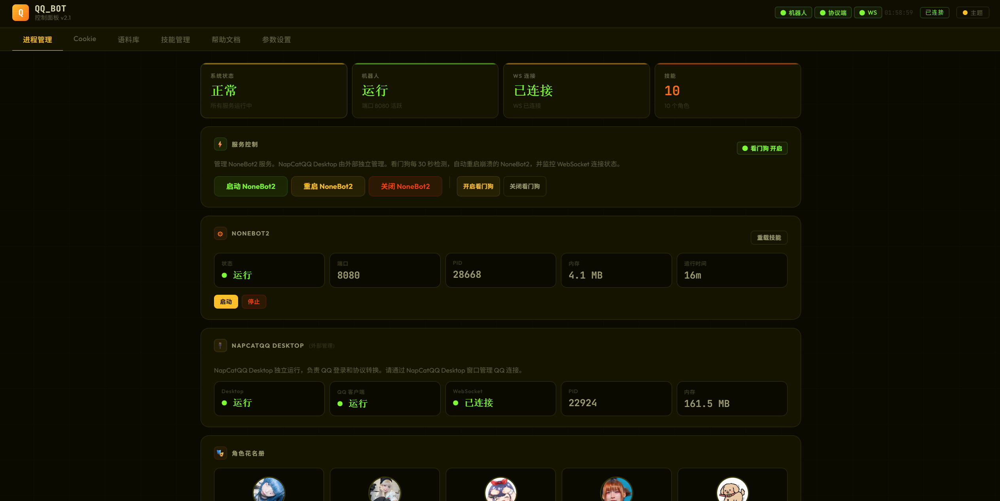

<div align="center">

# 🎭 qqbot-multiple-character

**基于 NoneBot2 + SnowLuma + 多 LLM Provider 的多角色扮演 QQ 机器人**

[](LICENSE)
[](requirements.txt)
[](#运行环境)
[](https://nonebot.dev)



**多角色随时切换 + 语料蒸馏 + 中文 Web 管理面板**  
**面向个人 / 小圈子长跑的多角色 QQ 机器人**

[快速开始](#快速开始) · [功能特性](#功能特性) · [Dashboard 管理面板](#dashboard-管理面板) · [角色 Skill 体系](#角色-skill-体系)

</div>

## 为什么是这个项目

**市面 QQ Bot 主要痛点**：

- 多是群助手 / 单 LLM Provider / 单角色，跟小圈子"一群人想跟 bot 玩一天、第二天让 bot 换 A 角色"的场景对不上
- 角色定义散落各处（人设 / 上下文 / 工作方式），新角色光靠手写维护成本高
- 没有面向个人部署的中文 Web 管理面板，配置和日志全要命令行

**本项目解法**：

- **多角色随时切换**：每个角色 = 独立 Skill（人设 + 工作方式），群聊/私聊用 `/switch <角色名>` 切；今天 A，明天 B，bot 工作方式跟着角色走
- **个人本地化部署**：API Key 在你的 `private/.env`，语料在本地 `corpus/`，角色在本地 `qqbot/skills/` —— **不依赖任何中心化服务**，关掉外网也能跑
- **语料→Skill 蒸馏**：微博 / 推特 / QQ 聊天 → DeepSeek 自动生成 7 层结构 persona，**10 分钟造新角色**
- **多 LLM Provider 双轨**：DeepSeek 跑对话主力 + MiniMax M3 跑图片描述，**永远两个 provider 同时在线互不干扰**，敏感词过滤不会因为 context 触发
- **中文 Web 管理面板**：8 套主题切换 + 实时 turn 流 + 一键启停 + watchdog 自动重启 + 端口自动清理

## 快速开始

> **Windows 专属**。Mac / Linux 用户需自行替换 SnowLuma 版本、调整启动脚本和路径。

### 前置条件

| 软件 | 要求 | 下载 |
|------|------|------|
| Python | 3.10+（安装时**务必勾选** "Add to PATH"） | [python.org](https://www.python.org/) |
| QQ 桌面版 (QQNT) | 最新版 | [im.qq.com](https://im.qq.com/) |
| SnowLuma | 最新版 OneKey 版（v1.10.3+） | [SnowLuma Releases](https://github.com/NapNeko/snowluma/releases) |
| DeepSeek API Key | 必填 | [platform.deepseek.com](https://platform.deepseek.com) |
| MiniMax API Key | 强烈建议（多模态识图用） | [api.minimaxi.com](https://api.minimaxi.com) |
| Git | 任意版本 | [git-scm.com](https://git-scm.com/) |

### 安装

```bat
:: 1. 克隆仓库
git clone https://github.com/KP-i2/qqbot-multiple-character.git
cd qqbot-multiple-character

:: 2. 一键安装依赖 + 创建 venv
scripts\bat\setup.bat

:: 3. 编辑配置（填入 API Key / 管理员 QQ 号）
notepad private\.env

:: 4. 下载 SnowLuma 到 snowluma\ 目录（解压 zip 得到 snowluma\SnowLuma-xxx\node.exe）
::    从 https://github.com/NapNeko/snowluma/releases 下载 SnowLuma.Shell.Windows.OneKey.zip

:: 5. 写 SnowLuma 反向 WebSocket 配置
scripts\bat\setup_snowluma.bat

:: 6. 启动 Dashboard（统一管理 bot + SnowLuma）
manage.bat
```

打开 `http://localhost:8501`，输入你在 `.env` 里设置的 `DASHBOARD_TOKEN`，进入管理面板。

详细分步说明见 [docs/INSTALL.md](docs/INSTALL.md)。

### QQ Bot 命令

| 命令 | 说明 | 权限 |
|------|------|------|
| `/skills` | 查看所有可用角色 | 所有人 |
| `/switch <角色名>` | 切换角色 | 仅管理员 |
| `/current` | 查看当前角色和模型 | 所有人 |
| `/reset` | 清空对话记忆 | 所有人 |
| `/reloademoji` | 热重载表情文件 | 仅管理员 |

私聊直接发消息，群聊 @Bot 触发回复。

## 功能特性

### 联网搜索

Bot 内置多源联网搜索（百度 + 微博 + 搜狗 + DuckDuckGo Instant Answer），当用户消息包含搜索意图关键词或 URL 时自动触发。Function Calling 让模型自主决定是否搜索、搜什么、是否跟进网页内容，最多 3 轮工具调用。

可通过 `private/.env` 中 `WEB_SEARCH_ENABLED=false` 关闭，或通过 Dashboard 参数设置动态调整。

### URL 内容抓取

用户消息含 URL 时 Bot 自动抓取页面内容并注入上下文。支持：

- **Bilibili**：解析 BV 号，通过 API 获取视频标题 / 简介 / 播放量
- **短链接**：自动解析 302 重定向获取真实地址
- **普通网页**：提取正文（去 HTML 标签，截断超长内容）

### 情绪表情系统

Bot 根据对话内容的情绪自动发送对应表情图片。表情文件按情绪分类存放在 `emoji/` 目录下，每个子目录含 `keywords.txt` 定义触发词。

当前支持 10 种情绪：`angry / biaoxian / chigua / ganga / haoqi / happy / joker / ota / refuse / sad`

触发规则：50% 概率触发 + 同用户 60 秒冷却。管理员可通过 `/reloademoji` 热重载。

### 流式输出

默认启用流式回复。先通过一次非流式"探测"判断是否需要工具调用，若为普通文本则切换流式 + 分段发送。流式参数（累积字符数 / 间隔 / 最小字符数 / 单次最大）可通过 Dashboard 动态调整，**无需重启**。

### 多模态识图（MiniMax M3 原生支持）

用户发图片时 bot 自动识别图内容并自然回应（不区分表情包 / 截图 / 自拍）。

数据流：

```
QQ 图片消息 → SnowLuma (OneBot v11 image segment, 含 cdn url)
           → bot 提取 url → OpenAI 兼容 multimodal content
           → MiniMax M3 服务端 fetch 图片 → 视觉理解
```

**关键设计**：MiniMax 服务端 fetch 图片，**零带宽零编解码**；历史里**只存文字占位符**（如 `[用户上一条消息里发了一张图片]`），省 token。纯 HTTP 协议，不需要 headless Chrome / Playwright。

### LLM Provider 双轨架构

**两个 Provider 永远同时在线，分工明确**：

| Provider | 模型 | 角色 | 适用场景 |
|---|---|---|---|
| **DeepSeek**（默认主对话） | `deepseek-chat` | 处理**所有对话 / 工具调用 / 流式 / 用户画像** | 成本低、JSON 模式稳定、人设语气好、不被敏感词过滤卡 |
| **MiniMax M3**（视觉描述专用） | `MiniMax-M3` | **只做图片描述**：把图片转成纯文字 | 多模态强，但有自带敏感词过滤（不适合直接对话） |

调用流程：

```
用户发消息（含/不含图片）
   │
   ├─ 不含图 ────────────────────→ 直接 DeepSeek 处理回复
   │
   └─ 含图 → MiniMax 看图 → 输出 [图片描述: ...] 文字
                              ↓
                           DeepSeek 拿纯文本（含描述）处理回复
```

**关键设计**：MiniMax **永远只接收图片**（+用户文字提示），**不接触对话历史 / persona / thinking**。这样 MiniMax 自带的敏感词过滤不会因为历史里有什么被触发。

**Provider 切换策略**（两个 Provider 独立，无自动 fallback）：
- 主选不可用 → 抛 `RuntimeError`，bot 报错；需 Dashboard 手动切主选或修 `.env`
- 历史曾有"minimax 失败自动切 deepseek"兜底，**已移除**——避免"幽灵调用"

启用 / 禁用：`private/.env` 里 `MINIMAX_ENABLED=true|false`、`DEEPSEEK_ENABLED=true|false`。

### 用户画像

Bot 在对话过程中自动提取用户画像（称呼偏好、兴趣话题等），作为上下文注入后续回复，让角色"记住"对方特点。画像由 DeepSeek 抽取，定期更新，不影响对话性能。

### 对话流水（turn 流）

Dashboard 「对话流水」tab 通过 SSE 实时推送每个 turn 的完整步骤：

- **状态流转**：排队 → 探测 → LLM 调用 → 思考 → 工具调用 → 工具结果 → 流式分块 → 回复
- **元信息**：用户 QQ、群 ID、角色、Provider / Model、工具调用数、回复字符数、耗时
- **聚合统计**：总 turn 数 / 成功率 / 空回复率 + Provider + Skill + 高频用户分布
- **筛选搜索**：按状态 / 关键字过滤

文件落地在 `qqbot/data/turns_stream.jsonl`（追加写，自动 gitignore）。

## 角色 Skill 体系

每个角色是一个独立的 Skill —— 一个 `qqbot/skills/<角色名>/` 目录，至少包含：

```
qqbot/skills/角色名/
├── SKILL.md       # 元数据（角色名 / 描述 / 版本）
├── persona.md     # 七层人设（核心规则 → 关系 → 表达DNA → 情感 → 冲突 → 记忆）
└── work.md        # 可选 — 工作方式（接什么活 / 怎么接）
```

**预置示例角色**：`makise-kurisu` —— 命运石之门 牧瀬紅莉栖，完整人设 + 工作方式样例，可直接跑，也可作自己造新角色的模板。

### 造新角色的三种方式

| 方式 | 速度 | 适合 |
|---|---|---|
| **从零手写** | 30 min - 2 h | 已经想清楚人设 |
| **从语料蒸馏** | 10 min | 有微博 / 推特 / QQ 聊天 → 自动生成 7 层结构 persona |
| **从克隆修改** | 15 min | 复制 `qqbot/skills/makise-kurisu/` 改 meta + persona |

蒸馏流程在 Dashboard → 语料库 → 抓取 → 「生成技能」一键完成。

### 多角色切换

群聊 / 私聊用 `/switch <角色名>` 命令切换角色（仅管理员可切）。所有用户从下一条消息起看到新角色。**热切换无需重启**，bot 加载新 persona 后立即生效。

### 仓库 vs 本地的角色

| 在哪儿 | 内容 | 怎么管 |
|---|---|---|
| **本仓库 (GitHub)** | 只提交 `makise-kurisu/` 作为模板示例 | `.gitignore` 排除其余 |
| **你本地** | 你的 N 个真实角色 | `qqbot/skills/<角色名>/`（不提交） |
| **运行时加载** | bot 启动时扫描 `qqbot/skills/` 下所有目录 | 自动 |

> 这样 GitHub 公开仓库和你的隐私角色天然分离 —— 你的圈子、叫法、人物分析不会因为公开仓库泄漏。

## Dashboard 管理面板

访问 `http://localhost:8501`（`DASHBOARD_TOKEN` 鉴权）

| 页面 | 功能 |
|------|------|
| 进程管理 | KPI 总览、服务启停、Dashboard 自管理、看门狗、角色花名册 |
| Cookie | 微博 / 推特 Cookie 状态查看与上传 |
| 语料库 | 微博抓取 / QQ 群聊导入 / 推特抓取 / 文本导入 / 语料 → Skill 生成 |
| 技能管理 | 角色 Skill 列表 / 编辑 / 蒸馏 / 创建 / 批量删除 + 头像自动加载 |
| 日志 | 系统日志实时查看（chat.log / nonebot2.log / snowluma.log 等） |
| 帮助文档 | 文档目录侧边栏 + Markdown 渲染 |
| 参数设置 | LLM Provider 切换 + 流式 / 历史 / 联网搜索 / MiniMax 全参数运行时调整 |
| 对话流水 | turn 流实时 SSE + 历史聚合统计 |

**架构**：

- **后端**：FastAPI + Uvicorn，`main.py` 集中路由，`monitor.py` 用 psutil 进程监控 + 看门狗
- **前端**：原生 HTML / CSS / JS，**模块化拆分**（17 个 js + 7 个 css）+ 8 套主题
- **API 鉴权**：`X-Dashboard-Token` header 或 `?token=` query；EventSource 走 query
- **状态持久化**：自动记住上次访问的标签页 + 表单草稿保存

## 文档目录

- [docs/INSTALL.md](docs/INSTALL.md) — 详细安装指南（Windows 一步步）
- [docs/USAGE.md](docs/USAGE.md) — 使用说明（bot 命令 + Dashboard 全 tab + 调参）
- [docs/SKILL_AUTHORING.md](docs/SKILL_AUTHORING.md) — 角色创作 + 7 层 persona 模板 + 蒸馏流程
- [docs/SECURITY.md](docs/SECURITY.md) — 隐私 + 安全（什么绝不能进仓库 / sanitize 用法）

## 技术栈

| 组件 | 技术 |
|------|------|
| Bot 框架 | NoneBot2 + OneBot V11 Adapter |
| QQ 协议 | SnowLuma（基于 QQNT 的 OneBot v11 实现） |
| 主对话 LLM | DeepSeek（默认） |
| 视觉 LLM | MiniMax M3（图片描述专用） |
| 联网搜索 | 百度 + 微博 + 搜狗 + DuckDuckGo |
| 推特抓取 | twikit（纯 HTTP，Dashboard 一键调用） |
| 微博抓取 | Playwright + Cookie 注入 + 浏览器内 AJAX |
| Dashboard | FastAPI + Uvicorn + WebSocket + SSE |
| 前端 | 原生 HTML / CSS / JS（17 js + 7 css，8 套主题） |
| 语料蒸馏 | DeepSeek API |
| 进程监控 | psutil + asyncio 看门狗 |
| 服务管理 | `manage.bat`（端口自动清理 + PID 追踪） |

## 目录结构

```
qqbot-multiple-character/
├── .gitignore                      # 覆盖运行时/隐私/构建产物
├── README.md                       # 你正在看
├── LICENSE                         # MIT
├── requirements.txt                # Python 依赖
├── manage.bat                      # 统一管理入口（启 Dashboard）
├── private/                        # 隐私配置（gitignore）
│   ├── .env.example                # 复制为 .env 后填 API Key
│   ├── cookies.json                # 微博 Cookie（用户自传）
│   └── twitter_cookies.json        # 推特 Cookie（用户自传）
├── qqbot/
│   ├── bot.py                      # NoneBot2 入口（启 8080）
│   ├── dashboard.py                # Dashboard 入口（启 8501）
│   ├── pyproject.toml              # NoneBot 插件配置
│   ├── plugins/zyw_chat/           # 核心聊天插件（21 个模块）
│   ├── dashboard/                  # Web 管理面板（FastAPI + 前端）
│   ├── skills/makise-kurisu/       # 唯一示例角色（其他本地自建，不入库）
│   └── snowluma_onebot_config.example.json # SnowLuma 反向 WS 配置模板
├── scripts/
│   ├── fetch_twitter.py            # 推特语料抓取（twikit）
│   ├── sanitize.py                 # 发布前隐私自检
│   ├── weibo_pw_cookies.py         # 微博语料抓取（Playwright）
│   └── bat/                        # 启动 / 设置 / 快捷方式脚本
├── emoji/                          # 10 种情绪表情（含 keywords.txt）
├── photo/                          # 角色头像（每个角色一个子目录）
├── corpus/makise-kurisu_SG/        # 示例语料（SG 牧瀬紅莉栖公开台词）
└── docs/                           # 文档
    ├── dashboard.png
    ├── INSTALL.md
    ├── USAGE.md
    ├── SKILL_AUTHORING.md
    └── SECURITY.md
```

**运行时自动创建**（已在 `.gitignore` 中，无需手动建）：

- `skill_qqbot/` — Python venv
- `qqbot/logs/` / `qqbot/data/` — 日志 + 运行时持久化
- `logs/` / `.runtime/` — Dashboard 日志 / PID 文件
- `corpus/` — 抓取时自动创建

**需要手动添加**：

- `emoji/*/` — 表情图片（GIF / JPG / PNG）
- `photo/<角色名>/avatar.*` — 角色头像

## 常见问题

**Q: setup.bat 提示找不到 Python？**  
A: 确保安装 Python 时勾选了 "Add to PATH"，或手动将 Python 添加到系统环境变量 PATH。

**Q: manage.bat 提示找不到 SnowLuma？**  
A: 下载 SnowLuma 并解压到 `snowluma/` 目录，确保 `snowluma\SnowLuma-v1.10.3-win-x64\node.exe (snowluma)` 存在。

**Q: Bot 启动但 QQ 收不到消息？**  
A: 按顺序检查：

1. SnowLuma 是否扫码登录成功（看 `qqbot/logs/snowluma.log`）
2. 是否已运行 `setup_snowluma.bat` 写入连接配置
3. NoneBot2 是否正常运行（端口 8080 应处于监听状态）

**Q: Dashboard 打不开 / 端口被占用？**  
A: `manage.bat` 等价命令（见 Dashboard 网页）`restart dashboard` 自动清理旧进程并重启。

**Q: Bot 重启后端口冲突 (Errno 10048)？**  
A: `manage.bat` 和 Dashboard 网页端的启动 / 重启操作都会自动清理端口残留进程。

**Q: API 报错 401？**  
A: 检查 `private/.env` 中的 `DEEPSEEK_API_KEY` / `MINIMAX_API_KEY` 是否填写正确且账户余额充足。

**Q: 切换主选 Provider 后没生效？**  
A: Dashboard「参数设置」→「活动 LLM Provider」选择 + 保存即可热切换。下次新 turn 立即生效，无需重启。

更多 FAQ 见 [docs/SECURITY.md](docs/SECURITY.md)。

## Roadmap

接下来想做的事：

- [ ] **多 Bot 实例管理**（同一进程跑多个 QQ 号，独立 / 角色分发）
- [ ] **角色记忆图谱**（用 Neo4j 关联角色关系 / 用户画像交叉）
- [ ] **语音消息 TTS 回复**（Edge TTS / GPT-SoVITS / 用户自训音色）
- [ ] **Web 管理面板移动端适配**（PWA / responsive layout）
- [ ] **Config UI 化**（Dashboard 直接编辑 `.env`）
- [ ] **多语料源聚合蒸馏**（同时混微博 + 推特 + QQ 群聊生成 7 层结构 persona）

## Contributing

欢迎提 Issue / PR：

1. **Bug 报告**：[Issues](https://github.com/KP-i2/qqbot-multiple-character/issues) 里附 `chat.log` / `nonebot2.log` 片段 + 复现步骤
2. **Feature 提案**：先开 Issue 讨论设计方向，确认方向再发 PR
3. **PR 流程**：
   - Fork → 新分支开发 → 本地跑 `manage.bat` 确认 bot 能启动 + Dashboard 能打开
   - 跑 `python scripts/sanitize.py --check-only` 确保无 API key / 真号泄露
   - PR 描述里说明改动动机 + 测试方式
4. **代码风格**：参考 `qqbot/plugins/zyw_chat/*.py` 现有模块风格（中文 docstring + 模块化拆分）

### ⚠️ 不要提交的东西

| 类型 | 例子 |
|---|---|
| API keys | `sk-xxx` / `sk-cp-xxx` |
| 真实 QQ 号 / OneBot 号 | 任何 QQ 号段 |
| 你的真实角色目录 | `qqbot/skills/{aoyi,dot_yuu,...,zyw}/` 等 |
| `private/.env` / `private/cookies.json` / `private/twitter_cookies.json` | — |
| `corpus/*/tweets_raw.json` / `corpus/*/corpus.txt`（含真人微博 / 推特原文） | — |
| 任何 QQ 群聊记录（含真人头像 / QQ 号） | — |

> 这些都在 `.gitignore` 里拦了，但 PR 时还是麻烦人工 review。
> 跑 `python scripts/sanitize.py --check-only` 可以批量检查整库。

## 致谢

- [SnowLuma](https://github.com/NapNeko/snowluma-Desktop) — 基于 QQNT 的 OneBot v11 协议实现，本项目的 QQ 协议层依赖
- [MiniMax](https://api.minimaxi.com) — 图片描述专用 LLM Provider
- [titanwings/colleague-skill](https://github.com/titanwings/colleague-skill) — 角色 Skill 体系（`.skill` 目录结构、`SKILL.md` 元数据 + `persona.md` 七层人设 + `work.md` 工作方式）以及语料蒸馏为 AI Skill 的理念来源

## License

[MIT](LICENSE)