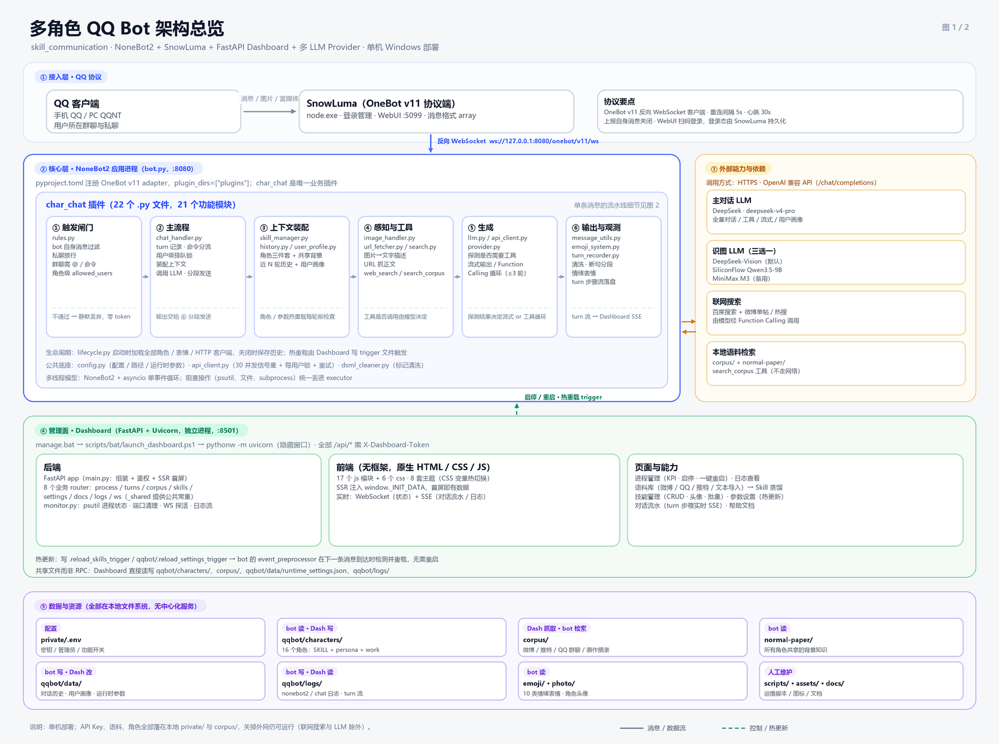

<div align="center">

# 🎭 QQ Bot 多角色扮演系统

**基于 NoneBot2 + SnowLuma + 多 LLM Provider 的多角色扮演 QQ 机器人**

[](LICENSE)
[](requirements.txt)
[](#快速开始)
[](https://nonebot.dev)
[](https://github.com/MaaYYDS/SnowLuma)



**多角色随时切换 · 语料 → Skill 蒸馏 · 中文 Web 管理面板**  
面向个人 / 小圈子长跑，单机本地部署，角色、语料、密钥都在你自己机器上

[快速开始](#快速开始) · [功能亮点](#功能亮点) · [架构速览](#架构速览) · [文档导航](#文档导航) · [常见问题](#常见问题) · [FAQ](docs/FAQ.md)

</div>

---

## 这个项目解决什么

市面上的 QQ Bot 大多是「群助手 / 单角色 / 单 Provider / 只有命令行」，而小圈子长跑的真实需求是：**今天 A 角色、明天 B 角色，人设和工作方式跟着角色走**。

- 🎭 **角色即 Skill**：一个角色 = 一个目录（`SKILL.md` + `persona.md` + `work.md`），`/switch` 热切换，不重启
- 🏠 **完全本地化**：API Key 在 `private/.env`、语料在 `corpus/`、角色在 `qqbot/characters/`，不依赖中心化服务
- 🧪 **10 分钟造角色**：微博 / 推特 / QQ 聊天语料 → DeepSeek 自动生成七层人设
- 🖥️ **中文 Web 面板**：进程启停、日志、语料采集、Skill 蒸馏、参数热改、对话流水，不用碰命令行
- 🔀 **四轨 LLM**：DeepSeek 主对话；识图默认 deepseek-vision，可选 SiliconFlow / MiniMax 备用，互不互相兜底

> 效果示例：`User: 今天吃了啥` → `Bot: 下午吃了三明治和咖啡呢～ 这周 lofter 发了新图你要看不`  
> 发图会自动转成文字描述再回复；问实时信息会走联网搜索，最后用角色语气说出来。

## 功能亮点

| 能力 | 说明 |
|---|---|
| 🎭 多角色热切换 | `/switch <角色名>` 立即生效；每个角色独立人设、语气、可用工具与访问白名单 |
| 🖼️ 多模态识图 | 图片自动转文字描述（默认 `deepseek-vision`，可切 SiliconFlow / MiniMax） |
| 🔍 联网搜索 | DeepSeek 官方 Search API（自研搜索，带来源/日期/摘要，实测 0.2~0.4s），由模型经 Function Calling 自主决定是否搜索 |
| 💬 流式回复 | 探测式路由：不需要工具就走流式分段，需要工具就走工具循环（≤3 轮） |
| 🧠 记忆与画像 | 多轮历史 + 用户画像（称呼偏好/兴趣），可调轮数与 TTL |
| 😀 情绪表情 | 10 类情绪、关键词触发、50% 概率 + 用户冷却，可热重载 |
| 📊 对话流水 | 每个 turn 的完整步骤经 SSE 实时推到 Dashboard，附聚合统计 |
| 🧬 语料蒸馏 | 微博 / 推特 / QQ / 文本导入 → 一键生成七层 persona |
| 🎨 8 套主题 | Dashboard 原生前端 + CSS 变量热切换，SSR 首屏直出 |
| 🔒 隐私隔离 | 公开仓库只带 2 个 anime 示例角色，真实角色/语料/密钥只留本地 |

细节见 [docs/FEATURES.md](docs/FEATURES.md)。

## 架构速览

```text
QQ 客户端 ←→ SnowLuma（OneBot v11 协议端，WebUI :5099）
                ↕  反向 WebSocket ws://127.0.0.1:8080/onebot/v11/ws
          NoneBot2（:8080） + char_chat 插件
                ├─ 触发规则 → 主流程 → 上下文装配 → 工具/LLM → 分段发送
                ├─ DeepSeek 主对话 / deepseek-vision 识图 / SiliconFlow / MiniMax
                └─ DeepSeek Search API、语料检索、表情系统、turn 记录
                ↕
      Dashboard（FastAPI :8501）— 进程管理 / 日志 / 语料 / Skill / 参数 / 对话流水
```

三个独立进程统一由 Dashboard 托管（桌面「QQ Bot」快捷方式或 `scripts\bat\start_stack.ps1` 启动）；`char_chat` 插件是唯一业务插件（21 个功能模块）。
完整架构、目录结构、Provider 细节、运行环境见 [docs/ARCHITECTURE.md](docs/ARCHITECTURE.md)，单条消息链路见 [docs/message-flow.png](docs/message-flow.png)。

## 快速开始

**前置条件**（Windows 10/11）：

| 依赖 | 说明 |
|---|---|
| Anaconda / Miniconda | 用于创建 `botenv`（Python 3.12）；默认路径 `D:\Work\anaconda3\`，自定义路径需改 4 处常量，见 [docs/INSTALL.md](docs/INSTALL.md) |
| SnowLuma v2.2.0 | [Releases](https://github.com/MaaYYDS/SnowLuma/releases) 下载 win-x64 zip（自带 node.exe） |
| LLM API Key | DeepSeek 必填；SiliconFlow / MiniMax 可选 |

**第 1 步：装 Python 环境**

```bat
scripts\bat\setup.bat
```

自动创建 conda env `botenv`、装 requirements、装 Playwright Chromium、生成 `private\.env` 模板。

**第 2 步：填 `private\.env`（最小可用）**

```ini
HOST=0.0.0.0
PORT=8080
COMMAND_START=["/"]
DEEPSEEK_API_KEY=sk-你的DeepSeek密钥
DEEPSEEK_VISION_ENABLED=true          # 识图默认走 DeepSeek 官方多模态
ADMIN_QQ=你的QQ号                      # /switch 等管理员命令按此匹配
DASHBOARD_TOKEN=自定义一个密码
DEFAULT_SKILL=makise-kurisu          # 公开仓库自带示例角色
```

> 全部配置项（可选 Provider / 搜索 / 行为 / 运行时参数）见 [docs/CONFIG.md](docs/CONFIG.md)。

**第 3 步：装 SnowLuma v2.2.0**

1. 手动新建 `snowluma\SnowLuma-v2.2.0-win-x64\`，把 zip 里的根级文件解压进去（`node.exe` / `index.mjs` / `client/` / `native/`）
2. 运行 `scripts\bat\setup_snowluma.bat` 写入反向 WS 配置（已存在配置不会覆盖）
3. 首次登录：启动后打开 WebUI `http://localhost:5099` → 同意 EULA/隐私政策 → 输入机器人 QQ 号 → 扫码

**第 4 步：启动与关闭**

- 启动：双击桌面 **「QQ Bot」** 快捷方式（等价于 `powershell -NoProfile -ExecutionPolicy Bypass -File scripts\bat\start_stack.ps1`）
- 关闭：双击桌面 **「停止 QQ Bot」** 快捷方式（等价于 `scripts\bat\stop_stack.ps1`：优雅停 NoneBot2 / SnowLuma，再关 Dashboard）
- 只想停机器人、保留面板：打开 `http://localhost:8501`，点顶部 **「关闭 NoneBot2」**

启动会后台拉起 Dashboard → 自动启动 SnowLuma + NoneBot2 → 等 WebSocket 连上后自动打开 `http://localhost:8501`。
（也仍可在 Dashboard 里手动启停 / 重启单个进程。）首次使用登录 Dashboard，Token 即 `DASHBOARD_TOKEN`。

**第 5 步：验证**

私聊机器人发 `/current` 应返回当前角色；群聊需 **@机器人** 或发 `/` 命令才会回复（`test_mode` 默认只拦非管理员）。
完整安装、验证与卸载见 [docs/INSTALL.md](docs/INSTALL.md)。

## 常用命令

| 命令 | 说明 | 权限 |
|---|---|---|
| `/skills` | 查看所有角色 | 所有人 |
| `/current` | 查看当前角色和模型 | 所有人 |
| `/reset` | 清空当前对话记忆 | 所有人 |
| `/switch <角色名>` | 切换角色（热切换） | 管理员 |
| `/reloademoji` | 热重载表情文件 | 管理员 |
| `/testmode on\|off` | 测试模式开关（只拦非管理员） | 管理员 |

触发规则：**私聊直接发**；**群聊 @机器人 或 `/` 命令**；白名单群概率接话已于 2026-09 移除。详见 [docs/USAGE.md](docs/USAGE.md)。

## 角色体系

一个角色 = 一个目录，公开仓库只带 2 个 anime 示例（`makise-kurisu` / `amadeus-kurisu`），其余角色在作者本地维护、不进入公开仓库：

```text
qqbot/characters/<角色名>/
├── SKILL.md       # 元数据 + 可选控制层正文
├── persona.md     # 七层人设
├── work.md        # 工作方式（可选）
├── modes/         # 模式库（可选）
└── corpus_ref/    # 造角色时的语料快照（可选）
```

`/switch` 后面写**目录名**。新建角色支持从零手写 / 语料蒸馏 / 克隆修改，字段与写法见 [docs/SKILL_AUTHORING.md](docs/SKILL_AUTHORING.md)。

## 仓库速览

```text
qqbot/                 # NoneBot2 应用
├── bot.py             # 入口（读 private/.env，注册 OneBot v11 adapter）
├── plugins/char_chat/ # 核心聊天插件（21 个功能模块）
├── dashboard/         # FastAPI 管理面板（routers + 原生前端）
├── characters/        # 角色目录（公开只带 2 个示例 + README）
└── data/ logs/        # 运行时数据与日志（本地生成，不入库）
docs/                  # 文档（安装/使用/配置/架构/FAQ/SOP…）
normal-paper/          # 共享背景知识（公开只有 README + examples）
scripts/               # 运维 / 抓取 / 安装脚本
snowluma/              # SnowLuma 运行时（自行下载，不入库）
private/ corpus/ photo/# 密钥、语料、头像（只留本地，不入库）
```

完整目录树见 [docs/ARCHITECTURE.md](docs/ARCHITECTURE.md#目录结构)。

## 文档导航

| 文档 | 内容 |
|---|---|
| [docs/INSTALL.md](docs/INSTALL.md) | 详细安装：前置条件、逐步配置、验证、卸载/重置 |
| [docs/USAGE.md](docs/USAGE.md) | 命令、触发规则、Dashboard 各页、表情/搜索/识图、语料采集与蒸馏 |
| [docs/CONFIG.md](docs/CONFIG.md) | `private/.env` 全参数 + Dashboard 运行时参数 |
| [docs/ARCHITECTURE.md](docs/ARCHITECTURE.md) | 架构、LLM Provider 四轨、Dashboard 架构、目录结构、运行环境、技术栈 |
| [docs/FEATURES.md](docs/FEATURES.md) | 功能特性详解与边界条件 |
| [docs/SKILL_AUTHORING.md](docs/SKILL_AUTHORING.md) | 角色创作：七层人设、front matter、蒸馏、测试 |
| [docs/SOP.md](docs/SOP.md) | 日常启停、角色调优、故障排查、备份 |
| [docs/SECURITY.md](docs/SECURITY.md) | 隐私边界、发布前自检、API Key 与用户数据 |
| [docs/FAQ.md](docs/FAQ.md) | 常见问题全量合集 |
| [docs/CHANGELOG.md](docs/CHANGELOG.md) | 更新日志 |
| [docs/RELEASE-2026-08-30.md](docs/RELEASE-2026-08-30.md) | 2026-08-30 Dashboard 重构发布说明 |

## 常见问题

- **群聊 @ 了不回？** 先看 `test_mode_enabled`（默认 true，只拦非管理员），再看顶部 WS 状态灯与 `chat.log`。
- **Dashboard / 对话流水 401？** Token 未填或过期：看 `private/.env` 的 `DASHBOARD_TOKEN`，或查 `qqbot/logs/dashboard.out` 里自动生成的随机 token。
- **发图 bot 不回描述？** 确认 `image_handler_enabled` 勾选、`DEEPSEEK_VISION_ENABLED=true`，以及对应平台余额。
- **Dashboard 里启动找不到 SnowLuma？** 必须是 `snowluma/SnowLuma-v2.2.0-win-x64/node.exe` 这一层，目录名保持 `SnowLuma-<版本>-win-x64`。
- **端口被占用（8080/8501）？** Dashboard 启停自带端口清理；仍失败见 [docs/SOP.md](docs/SOP.md) 故障排查。

更多问题见 [docs/FAQ.md](docs/FAQ.md)。

## Roadmap

- [ ] 多 Bot 实例管理（同一进程多 QQ 号，独立角色分发）
- [ ] 角色记忆图谱（角色关系 / 用户画像交叉关联）
- [ ] 语音消息 TTS 回复（Edge TTS / GPT-SoVITS）
- [ ] Dashboard 移动端适配（PWA / responsive）
- [ ] Config UI 化（面板内直接编辑 `private/.env`）
- [ ] 多语料源聚合蒸馏（微博 + 推特 + QQ 混训）

## Contributing

欢迎 Issue / PR：Bug 报告请附 `chat.log` / `nonebot2.log` 片段与复现步骤；Feature 先开 Issue 对齐方向；PR 前请跑 `python scripts/sanitize.py --check-only` 自检。

⚠️ **不要提交**：API Key、真实 QQ 号、真实角色目录、真人语料、群聊记录/群二维码。完整清单与发布边界见 [docs/SECURITY.md](docs/SECURITY.md)。

## 致谢

- [SnowLuma (MaaYYDS)](https://github.com/MaaYYDS/SnowLuma) — QQNT 的 OneBot v11 协议实现，本项目 QQ 协议层
- [DeepSeek](https://platform.deepseek.com) — 主对话 LLM Provider
- [SiliconFlow](https://cloud.siliconflow.cn) / [MiniMax](https://api.minimaxi.com) — 可选 / 备用视觉 Provider
- [titanwings/colleague-skill](https://github.com/titanwings/colleague-skill) — 角色 Skill 体系与语料蒸馏理念来源
- 所有在本地贡献过人设、语料与调优思路的朋友

## License

[MIT](LICENSE) · 更新日志见 [docs/CHANGELOG.md](docs/CHANGELOG.md)
